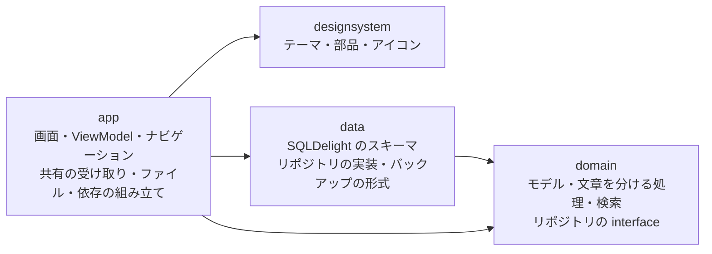

# recipe-book（Android）

育てるレシピ帳（仮称 recipe-book）の Android 版です。Kotlin + Jetpack Compose + SQLite（SQLDelight）で、サーバーを持たず、端末の中だけで動きます。構成と開発環境は training-log と同じです。

- 要件定義: [`../docs/requirements.md`](../docs/requirements.md)

## 動かす・確かめる

必要なもの: JDK 21、Android SDK（compileSdk 37、build-tools 36）。Android Studio は要りません（コマンドラインだけで動きます）。

```bash
cd apps/recipe-book/android

# SDK の場所を教える（コミットしない。local.properties は .gitignore に入っている）
echo "sdk.dir=/path/to/Android/Sdk" > local.properties

./gradlew :domain:test :data:test :app:testDebugUnitTest   # ユニットテスト
./gradlew :app:lintDebug                                   # Lint
./gradlew :app:assembleDebug                               # デバッグ APK（app/build/outputs/apk/debug/）
```

エミュレーターや実機に入れるときは、`adb install -r app/build/outputs/apk/debug/app-debug.apk`。
main に push すると、CI が同じ内容を確かめ、デバッグ APK を GitHub の [プレリリース `recipe-book-dev`](https://github.com/p-ota-q/inventory/releases/tag/recipe-book-dev) に置きます（スマホのブラウザから入れられます）。

共有の受け取りは、adb からも試せます。

```bash
adb shell "am start -a android.intent.action.SEND -t text/plain \
  --es android.intent.extra.TEXT 'https://youtu.be/xxxx' \
  --es android.intent.extra.SUBJECT '料理名 - YouTube' \
  -n io.github.otato.recipebook/.share.ShareActivity"
```

## 構成（責任ごとにモジュールを分ける）



| モジュール | 持つもの |
|-----------|----------|
| `domain` | モデル、貼り付けた文章を料理名・材料・手順に分ける処理（`RecipeTextParser`）、共有で受け取ったものの読み取り（`SharedContentReader`）、URL の正規化（`Urls`）、検索の正規化（`SearchText`）、一覧の絞り込みと並べ替え（`RecipeList`）、版の判断と材料の比較（`Versioning`）、リポジトリの interface |
| `data` | SQLDelight のスキーマ（`src/main/sqldelight`）、リポジトリの実装、バックアップの JSON の形、`DataModule`（入口） |
| `designsystem` | 色・文字のトークン、ボタン・チップ・ダイアログ・並べ替え（training-log から持ってきて、色だけ暖かくした） |
| `app` | 画面（Compose）、ViewModel、ナビゲーション、共有の受け取り（`ShareActivity`）、バックアップのファイル、`AppContainer` |

## 決めたこと

- **版は丸ごと持つ**: レシピの中身（何人分・材料・手順・ポイント）は版（`recipe_version`）が持ち、レシピは「いまの版」を指す。作ったあとに直すと、新しい版になる（`Versioning.needsNewVersion`）。まだ作っていないうちの修正や、同じ版のうちの続けての修正は、版を増やさない
- **一覧と詳細は、どのテーブルが変わっても読み直す**: `watchAll`（実行しない問い合わせ）で変更を見張る。レシピの量は多くても数千件なので、これで足りる
- **検索は Kotlin の側で行う**: 料理名・タグ・材料・ポイント・作った記録の文章をつなぎ、正規化（全角半角・カタカナとひらがなの違いをなくす）してから、部分一致で探す。SQLite の全文検索は、日本語の単語の区切りがないので使っていない
- **削除は印を付けるだけ**: 「元に戻す」のため。次に起動したときに、本当に消す
- **AI の API は使わない**: 文章を分けるのは、決まった手がかり（見出し・箇条書き・番号）だけで行う（要件 6.3）

## まだないもの

- URL からタイトルとサムネイルを取る（F-RC-03）。いまは、共有のときに送られてくる題名を使う
- 作ったレシピに、あとから文章を取り込む（F-CL-06）
- 作った記録の写真（F-LG-03）と、レシピの顔の写真（F-RC-09）
- AI 連携（要件の段階 2・3）
- e2e テスト（エミュレーターで動かすテスト）
