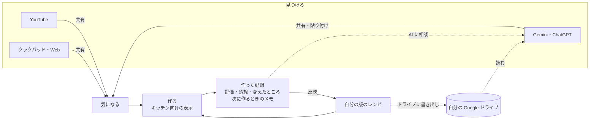
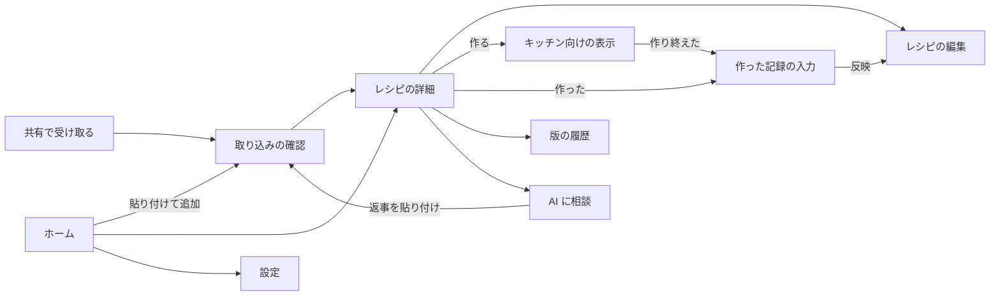
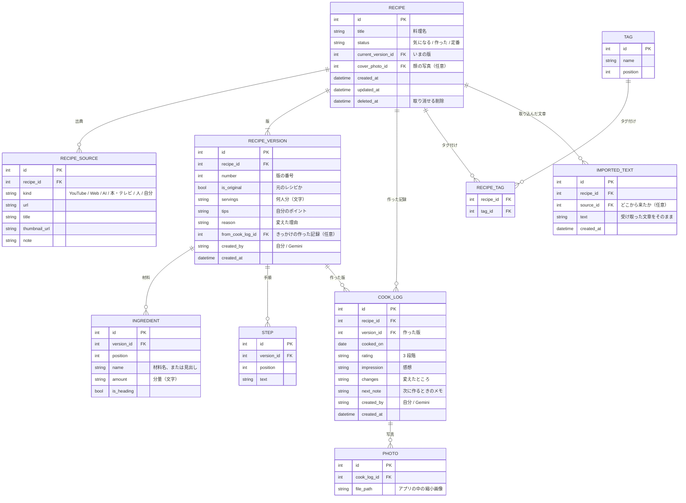
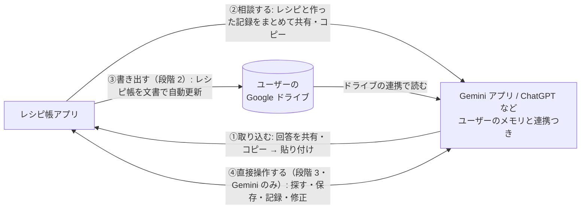
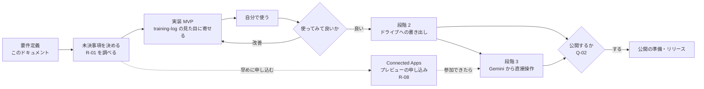

# 要件定義書（v0.3）

> 仮称: **recipe-book**（育てるレシピ帳。アプリ名は未定。ディレクトリ名も名称決定後に変更する）
> 作成日: 2026-11-23 / 更新日: 2026-11-23
> ステータス: MVP の範囲は確定し、実装に入る。デザインの工程（Claude Design）は省き、training-log の見た目に寄せて作り、触りながら直す。AI 連携（段階 2・3）は、MVP を使ってみてから進める。変更するときは版を上げ、変更点をコミットメッセージに残す。
> v0.2（2026-11-23）: Gemini が Google Keep に保存するのと同じように、Gemini からレシピ帳に保存・記録・修正できる経路（Google の Connected Apps と Android の AppFunctions）を、段階 3 として足した（4.6、7 章）。
> v0.3（2026-11-23）: Android アプリで作る（Q-01）、評価は 3 段階（Q-03）と決めた。AI 連携はいったん置き、MVP から「AI に相談」（F-AI-01〜05）を外して段階 2 に移した。共有・貼り付けでの取り込み（4.2）は、AI に限らず使うので MVP に残す。デザインの工程は省く（13 章）。

---

## 1. 背景と目的

### 1.1 背景

- レシピは YouTube・クックパッドなどで調べている。最近は Gemini や ChatGPT などの AI に聞くことも増えた（自分は、料理などの個人的なことは Gemini アプリを使っている）。
- 実際に作ってみると、感想（味が濃かった、思ったより時間がかかった）や、自分なりのアレンジ（醤油を減らした、きのこを足した）が出てくる。でも、それを残す場所が決まっていない。
- 見つけたレシピは、YouTube の「後で見る」、クックパッドの保存、AI の会話履歴、スクリーンショットに散らばる。動画は消えることもあり、AI との会話は流れていく。

### 1.2 いまの困りごとと、このアプリでの解決

| # | 困りごと | 解決する要件 |
|---|----------|--------------|
| P-1 | 見つけたレシピが、いろいろなアプリに散らばる | どのアプリからでも「共有」で 1 か所に集める（4.2 F-CL-*） |
| P-2 | 作ったときの感想やアレンジを忘れて、次も同じ失敗をする | 作った記録（4.4 F-LG-*）と「次に作るときのメモ」を残し、次に開いたとき最初に見える（F-LG-04） |
| P-3 | 自分の作り方が、元のレシピとどこが違うのか分からなくなる | 元のレシピと自分の版を分けて持ち、変えたところが分かる（F-RC-07、F-RC-08） |
| P-4 | 作りながら動画を何度も止めて見返す | 材料と手順を文章で持ち、キッチン向けの表示で見る（4.3 F-CK-*） |
| P-5 | AI に相談するたびに「前に作ったときは〜」と説明し直す | レシピと作った記録をまとめて AI に渡せる（4.6 F-AI-01〜03） |
| P-6 | AI に聞いたレシピが、会話の中に埋もれる | AI の回答をそのまま取り込める（F-CL-01、F-CL-05） |
| P-7 | AI が、自分のレシピ帳（定番・好み・失敗）を知らない | レシピ帳を自分の Google ドライブに書き出し、AI に読ませる（F-AI-06〜09） |
| P-8 | Gemini と話している途中で、アプリに移らずに保存・記録したい（Gemini が Google Keep にメモを保存するように） | Gemini からレシピ帳を直接操作できるようにする（F-AI-11〜15） |

### 1.3 目的

1. 調べたレシピを、作るたびに自分好みに育てていけるレシピ帳を作る（第一のユーザーは自分）。
2. Gemini・ChatGPT などの AI と行き来できるようにして、「調べる・相談するのは AI、記録して育てるのはレシピ帳」と役割を分ける。
3. 使ってみて良ければ公開する（するかどうかは Q-02）。

### 1.4 基本方針（全工程で守る）

| 方針 | 内容 |
|------|------|
| **育てる** | 1 回作るごとに、レシピが少しずつ自分好みになる。「作る → 感想 → 次の工夫 → レシピに反映」の流れを、いちばん短い操作でできるようにする。 |
| **AI はユーザーのものを使う** | アプリの中に AI（API）を組み込まない。ユーザーがふだん使っている Gemini アプリや ChatGPT に、レシピ帳を渡す・受け取る経路を作る。理由: API は別料金になるうえ、ユーザーが育ててきたメモリや Google の連携（Gmail・カレンダーなど）を使えない。 |
| **サーバーを持たない** | ログイン・アカウント・自前のサーバーを作らない。データは端末の中に置く。AI に読ませるための書き出しは、ユーザー自身の Google ドライブに置く。 |
| **画面で完結する** | ファイル形式・決まった書き方・コマンドを覚えさせない。「共有」ボタンと「貼り付け」で済ませる。AI に決まった形で答えてほしいときは、アプリが頼み方の文を用意する。 |
| **足しすぎない** | 献立・買い物リスト・栄養計算など、AI やほかのアプリでできることは作らない（3.2）。機能を足すときは「需要があるか」「いまの機能や AI で代わりにならないか」「ほかで代わりにならず、差別化になるか」で決める。 |

---

## 2. 対象ユーザーと使い方

### 2.1 対象ユーザー

| 区分 | 想定 |
|------|------|
| 主ユーザー | 自分。YouTube・クックパッド・AI でレシピを調べて自炊する。端末は Android。料理のことは Gemini アプリに聞く。 |
| 公開後のユーザー | 調べたレシピを自分流にアレンジして残したい人。レシピを AI で調べることが増えた人。 |

利用シーン:

| 場面 | 状況 | 求められること |
|------|------|----------------|
| 調べるとき | 動画・ページ・AI の回答を見ている。整理する気はない | 共有で数秒で放り込める。料理名の確認くらいで済む |
| 作るとき | スマホを立てかけている。手が濡れている・汚れている | 文字が大きい。画面が消えない。触る回数が少ない |
| 食べたあと | 感想を書く気力は少ない | 評価だけでも記録になる。1 分以内で書き終わる |
| AI と話すとき | 「この前作った〇〇を、もっとこうしたい」 | レシピと前回の感想を、説明し直さずに AI に渡せる |

### 2.2 使い方の流れ

レシピは「気になる → 作った → 定番」と育っていく。作るたびに記録を残し、次の工夫をレシピに反映する。



代表的な使い方:

| # | 場面 | 流れ |
|---|------|------|
| S-1 | YouTube で見つけた | YouTube の「共有」→ このアプリ → 料理名を確認して保存（気になる）。あとで「AI にまとめてもらう」で、動画の URL を付けた頼み方の文を Gemini に渡す → Gemini が材料と手順にまとめる → 回答をコピーして、そのレシピに貼り付ける |
| S-2 | Gemini に聞いたレシピ | Gemini の回答をコピー（または共有）→ このアプリで貼り付け → 料理名・材料・手順に自動で分かれる → 確認して保存 |
| S-3 | 作る | レシピを開く → いちばん上に前回の「次に作るときのメモ」（例: 塩は控えめに）→「作る」でキッチン向けの表示 → 作り終えたら評価と感想を入れる |
| S-4 | 次はもっとおいしく | レシピの「AI に相談」→「前回の感想をもとに改善して」を選ぶ → レシピと作った記録をまとめた文章が Gemini に渡る → 改善案を「次に作るときのメモ」に貼る、または新しい版として取り込む |
| S-5 | 今夜なにを作るか | Gemini で「レシピ帳から、鶏むね肉で作れて評価の良いものを出して」と聞く → Gemini がドライブのレシピ帳を読んで答える（段階 2）。段階 3 では、Gemini がアプリのレシピ帳を直接探す |
| S-6 | Gemini との会話の中で保存・記録する（段階 3） | Gemini に聞いたレシピを「@レシピ帳 これを保存して」。食べたあとに「@レシピ帳 ねぎ塩炒めを作った。塩を減らしたらちょうど良かった、と記録して」。改善案を「@レシピ帳 ねぎ塩炒めの塩を小さじ1/3に直して」。アプリを開かずに済む |

---

## 3. スコープ

### 3.1 リリース段階

| 段階 | 内容 | 目的 |
|------|------|------|
| **MVP**（自分用・Android） | レシピの登録（共有・貼り付け・手入力）、作った記録、次に作るときのメモ、キッチン向けの表示、検索、バックアップ | 調べる → 作る → 育てる が 1 つのアプリで回る |
| **段階 2**（AI と行き来する） | 「AI に相談」（レシピと作った記録をまとめて AI に渡す）と、自分の Google ドライブへのレシピ帳の書き出し（自動で更新） | 前回の感想ごと AI に相談でき、Gemini アプリなどがレシピ帳全体を知った上で答えられる |
| **段階 3**（Gemini から直接操作する） | Gemini の「つながっているアプリ」になり、Gemini からレシピの検索・保存・作った記録・修正ができる（Google の Connected Apps と Android の AppFunctions） | Gemini との会話の中で、アプリを開かずに保存・記録できる |
| **公開**（Q-02 で決める） | ストア公開に必要な対応 | 公開する |

AI 連携は、まずレシピ帳として使えるものを作ってから進める（v0.3 の判断）。Gemini から直接操作する仕組みがまだプレビューで、ドライブの文書を Gemini がどう読むか（形式・大きさ・スキルとの連携）も確かめる必要があるため（R-02〜R-04）。MVP でも、AI の回答をコピーして「貼り付けて追加」すれば、取り込める（4.2）。

段階 3 は、Google がアプリを Gemini につなぐ仕組み（Connected Apps）を 2026-10-28 にプレビューとして始めたばかりで、参加には申し込みが要り、日本・日本語で使えるかもまだ分からない（R-08）。参加できて、日本でも使えると分かったら、段階 2 より先にしてもよい（Q-07）。

### 3.2 やらないこと（スコープ外）

| やらないこと | 理由・代わりの方法 |
|--------------|--------------------|
| アプリの中の AI（API キー、自前の AI サーバー） | 1.4。ユーザーの Gemini・ChatGPT に渡す |
| 献立の作成・献立カレンダー | ドライブのレシピ帳を読んだ AI に「今週の献立を定番から決めて」と頼める |
| 買い物リスト | AI に頼む（Gemini なら Google Keep にリストを作れる）。メモアプリでもよい |
| 栄養・カロリーの計算 | AI に頼む |
| 人数に合わせた分量の計算 | 分量は「大さじ2」「少々」のように文字で持つので、計算すると間違いやすい。「AI に相談」で頼む |
| 調理タイマー | スマホのタイマーや Gemini で足りる |
| 写真や紙のレシピからの文字の読み取り | Gemini などで読み取ってもらい、回答を貼り付ける |
| レシピサイトの本文の自動取り込み | 著作権と各サイトの利用規約のため。取るのはタイトルとサムネイルだけ（F-RC-03、R-06）。本文は自分で書くか、AI にまとめてもらう |
| SNS（公開、フォロー、いいね）、レシピの公開・共有 | 自分のレシピ帳に集中する |
| ログイン、アカウント、自前のサーバー・データベース | 1.4 |
| 自前のサーバー（クラウドの MCP サーバー）を通した、AI からレシピ帳への読み書き | データをクラウドに置き、サーバーを動かす必要がある（1.4 に反する）。Gemini からの読み書きは、端末の中で動く AppFunctions で行う（段階 3）。7.2 で詳しく述べる |
| Gemini からのレシピの削除 | 間違って消えると戻せないため、Gemini から呼べる操作に削除は入れない。削除はアプリで行う |
| Web 版・タブレット専用レイアウト・多言語 | 日本語・スマホで始める |

---

## 4. 機能要件

優先度: **Must** = その段階に必須 / **Should** = 入れたい / **Could** = 余裕があれば・後回し。段階の指定がないものは MVP。

### 4.1 レシピ

| ID | 要件 | 優先度 |
|----|------|--------|
| F-RC-01 | レシピを作成・編集・削除できる。項目は、料理名・出典・何人分・材料・手順・自分のポイント（コツや注意）・タグ。料理名以外は空でもよい（リンクだけでも保存できる） | Must |
| F-RC-02 | 出典を複数持てる（例: 元のレシピの動画と、参考にした Web ページ）。種類は YouTube / Web ページ / AI（Gemini・ChatGPT など）/ 本・テレビ / 人から / 自分で考えた。URL があれば、元のアプリやブラウザで開ける | Must |
| F-RC-03 | URL から、タイトルとサムネイルを自動で取る（Web ページは OGP、YouTube は oEmbed）。本文は取らない。取れなくても保存はできる | Should |
| F-RC-04 | レシピの状態は「気になる（まだ作っていない）」「作った」「定番」の 3 つ。作った記録を付けると自動で「作った」になる。「定番」は自分で付け外しする | Must |
| F-RC-05 | 材料は 1 行に 1 つ、名前と分量で持つ。分量は文字のまま持つ（「大さじ2」「少々」「1/2個」）。行を並べ替えられる。見出し（「A」「タレ」など）を挟める | Must |
| F-RC-06 | 手順は番号付きで、1 つずつ持つ。並べ替えられる | Must |
| F-RC-07 | レシピの中身（何人分・材料・手順・ポイント）を変えたとき、前の内容を **版** として残す。版ごとに、いつ・なぜ変えたか（どの作った記録がきっかけか）が分かる。前の版に戻せる。版が増えるのは、作った記録から反映したときと、作ったあとに編集したとき。同じ日の続けての編集は 1 つの版にまとめる | Should |
| F-RC-08 | 元のレシピ（最初に保存した版）と、いまの自分の版の違いを見られる。変わった材料・手順に印を付け、変える前の値も出す（例: 醤油 大さじ2 → 大さじ1.5） | Should |
| F-RC-09 | 作った記録の写真から 1 枚を選んで、レシピの顔にできる。一覧に出す | Could |

### 4.2 集める（取り込み）

| ID | 要件 | 優先度 |
|----|------|--------|
| F-CL-01 | ほかのアプリの「共有」から URL や文章を受け取り、新しいレシピ（気になる）として保存できる。YouTube、ブラウザ、クックパッドのアプリ、Gemini・ChatGPT のアプリなど、共有に対応したアプリならどこからでもよい | Must |
| F-CL-02 | 共有で受け取ったときは、料理名（URL のタイトルから自動で入る）を確かめて保存するだけの小さな画面にする。保存したら元のアプリに戻る。タイトルの取得を待たずに保存できる | Must |
| F-CL-03 | 同じ URL のレシピがすでにあれば知らせ、新しく作るか、そのレシピを開くかを選べる | Should |
| F-CL-04 | アプリの中の「貼り付けて追加」で、コピーしてある文章や URL から、同じようにレシピを作れる | Must |
| F-CL-05 | 受け取った文章がレシピの形（「材料」「作り方」などの見出し、箇条書き、番号付きの手順。AI の回答によくある形）なら、料理名・何人分・材料・手順に自動で分ける。分けた結果は、保存する前に確かめて直せる。分けられなかった部分は、取り込んだ文章として全部残し、捨てない（6.3） | Must |
| F-CL-06 | 作ってあるレシピに、あとから文章を取り込める。材料・手順を置き換えるか（新しい版になる。F-RC-07）、「次に作るときのメモ」や自分のポイントに入れるかを選ぶ。例: 動画だけ保存したレシピに、AI がまとめた材料と手順を入れる。AI の改善案を取り込む | Should |

### 4.3 作るとき

| ID | 要件 | 優先度 |
|----|------|--------|
| F-CK-01 | 「作る」でキッチン向けの表示にする。文字とボタンを大きくし、材料と手順を見やすく並べる。表示している間は画面を消さない | Must |
| F-CK-02 | 表示のいちばん上に、前回の「次に作るときのメモ」と自分のポイントを出す | Must |
| F-CK-03 | 材料に「用意した」、手順に「終わった」のチェックを付けられる。終わった手順は薄くする。チェックはその回だけで、レシピには残さない | Should |
| F-CK-04 | 作り終えたら、そのまま作った記録の入力に進める | Must |
| F-CK-05 | キッチン向けの表示から、出典の動画やページを開ける | Must |

### 4.4 作った記録

| ID | 要件 | 優先度 |
|----|------|--------|
| F-LG-01 | レシピに「作った」を記録できる。項目は、日付（初期値は今日）・評価・感想・変えたところ（アレンジ）・次に作るときのメモ。日付以外は空でもよく、評価だけでも記録になる。どの版で作ったかも残す | Must |
| F-LG-02 | 評価は 3 段階（また作りたい / ふつう / いまいち。Q-03） | Must |
| F-LG-03 | 写真を付けられる。端末の中で縮小して保存する | Should |
| F-LG-04 | 最後に書いた「次に作るときのメモ」は、レシピを開いたときにいちばん上に出す。次の作った記録を入れるときにも出して、試したかどうかを感想に書きやすくする | Must |
| F-LG-05 | 作った記録の「変えたところ」を、レシピに反映できる。材料・手順の編集を開き、保存すると新しい版になる（F-RC-07） | Should |
| F-LG-06 | 作った記録を、レシピごと・全体の新しい順で見られる。何回作ったか・最後にいつ作ったかを、レシピの一覧と詳細に出す | Must |

### 4.5 探す

| ID | 要件 | 優先度 |
|----|------|--------|
| F-SR-01 | 料理名・材料・タグ・ポイント・作った記録の文章で検索できる（例: 「鶏むね」で、材料に鶏むね肉があるレシピも出る） | Must |
| F-SR-02 | 状態（気になる / 作った / 定番）とタグで絞り込める | Must |
| F-SR-03 | 並べ替え: 追加した順・最近作った順・作った回数の多い順・評価の良い順 | Should |
| F-SR-04 | タグを自由に作り、1 つのレシピに複数付けられる（例: 鶏肉、作り置き、10分） | Must |

### 4.6 AI と行き来する

AI との行き来には 3 つの経路がある（7.1）。「AI → レシピ帳」は 4.2 の共有・貼り付けで行う。

**レシピ帳 → AI（相談する。段階 2。v0.3 で MVP から移した）**

| ID | 要件 | 優先度 |
|----|------|--------|
| F-AI-01 | レシピの「AI に相談」で、レシピ（何人分・材料・手順・ポイント・出典の URL）と作った記録（評価・感想・変えたところ・次に作るときのメモ）を、AI に渡しやすい文章にまとめる（例は 7.3） | Must |
| F-AI-02 | 相談の目的を選ぶと、まとめた文章の最後に、頼みたいことを添える。目的は少なくする（例: 「前回までの感想をもとに改善して」「アレンジを考えて」「材料が足りないので代わりを教えて」。出典が動画・ページだけのレシピには「材料と手順にまとめて」）。添えた文は、送る前に書き足せる | Must |
| F-AI-03 | まとめた文章は、コピーするか、Android の共有で Gemini・ChatGPT などのアプリに直接送れる（直接送れるかは R-01） | Must |
| F-AI-04 | AI に答えの形（材料・作り方の見出しと箇条書き）を指定する一文を、頼む文に自動で入れる。答えをそのまま貼り付ければ、F-CL-05・F-CL-06 で取り込める。ユーザーは形を覚えなくてよい | Must |
| F-AI-05 | 相談から戻ってきたとき、そのレシピに「AI の返事を貼り付け」を出し、F-CL-06 の取り込みにすぐ進める | Should |

**AI がレシピ帳を読む（段階 2）**

| ID | 要件 | 優先度 |
|----|------|--------|
| F-AI-06 | レシピ帳の全体を、ユーザー自身の Google ドライブに文書として書き出す。レシピを変えたら自動で更新する。Gemini アプリの Google ドライブ連携や、ChatGPT の Google Drive の連携などで、AI がこの文書を読んで答えられるようにする | Must |
| F-AI-07 | 書き出す文書は、人が読んでも分かる形（見出しと箇条書き）にする。レシピごとに、状態・評価・作った回数・最後に作った日・タグ・出典・次に作るときのメモ・材料・手順・ポイント・最近の作った記録を入れる。写真は入れない（形は 7.3） | Must |
| F-AI-08 | 書き出しは片方向（アプリ → ドライブ）。ドライブで文書を直しても、アプリには戻らない。文書の冒頭にそう書いておく | Must |
| F-AI-09 | 書き出しのオン・オフ、書き出し先の確認、「今すぐ書き出す」を設定に置く。失敗しても静かに再試行し、続けて失敗したときだけ知らせる | Must |
| F-AI-10 | Gemini で文書を使う方法（ドライブを指定して聞く、スキルに文書をつなぐ など）を、アプリの中で短く案内する。案内だけで、設定は Gemini 側で行う | Could |

**Gemini から直接操作する（段階 3）**

Gemini が Google Keep にメモを保存するのと同じように、Gemini との会話の中から、レシピ帳を探したり、保存・記録・修正したりできるようにする。Android の AppFunctions を使い、操作は端末の中のアプリで実行する（データは端末の外に出ない。サーバーも要らない）。呼べる操作の一覧は 7.4。

| ID | 要件 | 優先度 |
|----|------|--------|
| F-AI-11 | Gemini から、レシピを探す・読む（材料・手順・ポイント・作った記録・次に作るときのメモ）操作を呼べる | Must |
| F-AI-12 | Gemini から、レシピを保存する（気になる）・作った記録を付ける・次に作るときのメモを足す操作を呼べる | Must |
| F-AI-13 | Gemini から、レシピの中身（何人分・材料・手順・ポイント）を直す操作を呼べる。直した内容は必ず新しい版になり（F-RC-07）、アプリで前の版に戻せる | Should |
| F-AI-14 | 書き込む操作（保存・記録・修正）は、実行の前に Gemini 側で確認が出るように設定する（Connected Apps の「確認が必要な操作」の設定）。削除の操作は用意しない | Must |
| F-AI-15 | Gemini が保存・記録・修正したものには「Gemini から」の印を付け、アプリを開いたときに新しく入ったものが分かるようにする | Should |

### 4.7 データ

| ID | 要件 | 優先度 |
|----|------|--------|
| F-DA-01 | 入力はすぐ端末に保存する。保存ボタンを押さなくても消えない | Must |
| F-DA-02 | 機種変更のためのバックアップを、写真も含めた 1 つのファイルに書き出し、読み込める。書き出し先はユーザーが選ぶ（ドライブも選べる） | Must |
| F-DA-03 | レシピや作った記録の削除は、しばらく取り消せる | Should |

### 4.8 設定

| ID | 要件 | 優先度 |
|----|------|--------|
| F-ST-01 | タグの管理（名前の変更・並べ替え・削除） | Must |
| F-ST-02 | テーマ（ライト / ダーク / 端末に合わせる） | Should |
| F-ST-03 | ドライブへの書き出し（F-AI-09） | Must（段階 2） |
| F-ST-04 | Gemini とのつなぎ方の案内（Gemini の設定の「つながっているアプリ」でこのアプリを有効にする、など） | Should（段階 3） |

---

## 5. 画面一覧（デザイン工程への入力）

デザインの工程は省き、training-log の見た目（色・文字・部品。主な操作は画面の下に置く）に寄せて作り、エミュレーターと実機で触りながら直す（v0.3）。ここでは「どんな画面が必要か」と「各画面で何ができるか」だけを決める。

| 画面 | 主な役割 |
|------|----------|
| ホーム（レシピの一覧） | 検索、状態・タグで絞り込み、並べ替え。「貼り付けて追加」と新規作成 |
| 共有で受け取る | 料理名を確かめて保存するだけの小さな画面（F-CL-02） |
| 取り込みの確認 | 自動で分けた料理名・何人分・材料・手順を確かめて直す。分けられなかった文章も見える（F-CL-05、F-CL-06） |
| レシピの詳細 | いちばん上に次に作るときのメモ。材料・手順・ポイント・出典・タグ・作った記録。「作る」「作った」。段階 2 で「AI に相談」 |
| レシピの編集 | 料理名・出典・何人分・材料・手順・ポイント・タグ・状態 |
| キッチン向けの表示 | 大きな文字の材料と手順、チェック、前回のメモ、出典を開く。画面を消さない |
| 作った記録の入力 | 日付・評価・感想・変えたところ・次に作るときのメモ・写真。レシピへの反映 |
| 版の履歴 | 版の一覧、元のレシピとの違い、前の版に戻す |
| AI に相談（段階 2） | 目的を選ぶ → 文章を確かめて書き足す → コピー / 共有で送る |
| 設定 | タグの管理、テーマ、ドライブへの書き出し（段階 2）、Gemini とのつなぎ方の案内（段階 3）、バックアップ |

段階 3 で Gemini から入ったものは、ホームとレシピの詳細に「Gemini から」の印で出す（F-AI-15）。専用の画面は作らない。



### 5.1 UX の原則

1. **放り込むのは数秒**: 共有から保存まで 2 タップ。整理はあとで、作るときでよい。
2. **前回が見える**: 次に作るときのメモが、レシピを開いて最初に目に入る。
3. **キッチンで使える**: 大きな文字とボタン、画面が消えない、触る回数が少ない。
4. **書くのは短く**: 評価だけでも記録になる。感想は空でよい。
5. **文章を捨てない**: 自動でうまく分けられなくても、取り込んだ文章は必ず残す。
6. **AI の答えの形はアプリが決める**: ユーザーは「コピーして貼る」だけ。決まった書き方を覚えさせない。

---

## 6. データ要件

### 6.1 データモデル（概要）



- 版は、そのときの何人分・材料・手順・ポイントを丸ごと持つ（差分ではない）。レシピ 1 つの量は小さいので、丸ごと持っても重くならない。
- 「次に作るときのメモ」は作った記録に持ち、レシピでは最後に書かれたものを出す。
- `created_by` は、段階 3 で Gemini が書いたものを見分けるため（F-AI-15）。新しく保存されたレシピは、最初の版の `created_by` で分かる。
- 実装での違い（v0.3 時点）: `IMPORTED_TEXT` の `source_id` は持たない（取り込んだ文章は、レシピにだけ結び付ける）。写真（`PHOTO`）と `cover_photo_id` は、写真の機能（F-LG-03、F-RC-09）を作るときに足す。

### 6.2 データの扱い

- データは端末の中のデータベースに置く。写真はアプリの中に縮小して置く（長辺 1600px 程度を目安。実装で見直す）。
- ドライブに書き出すのは文章だけ（写真は書き出さない）。
- バックアップのファイルは、このアプリで読み込むためのもの。ほかのアプリのデータの読み込みは作らない。

### 6.3 文章を自動で分ける考え方（F-CL-05）

- AI（API）は使わず、決まった手がかりで分ける。手がかりは「材料」「作り方」「手順」などの見出し、箇条書き、番号付きの行、「（2人分）」のような書き方。AI の回答（Markdown の見出しと箇条書き）と、レシピサイトの文章のコピーを主な対象にする。
- 「AI に相談」から頼んだ答えは、アプリが答えの形を指定しているので（F-AI-04）、分けやすい。
- うまく分けられなかったら、無理に分けずに文章をそのまま残し、ユーザーが確認画面で直す。受け取った文章は IMPORTED_TEXT に必ず残す。
- 実際の Gemini・ChatGPT の回答で試して、手がかりを足していく（R-01）。

---

## 7. AI 連携の設計方針

### 7.1 4 つの経路



| 経路 | できること | 使える AI | 段階 |
|------|------------|-----------|------|
| ① AI → レシピ帳（取り込む） | AI に聞いたレシピや改善案を、レシピ帳に入れる | どれでも | MVP |
| ② レシピ帳 → AI（相談する） | 1 つのレシピについて、前回までの感想を踏まえて相談する | どれでも | 段階 2 |
| ③ AI がレシピ帳を読む | レシピ帳の全体（定番・評価・失敗）を知った上で、献立や「何を作るか」を相談する | ドライブを読める AI（Gemini・ChatGPT など） | 段階 2 |
| ④ Gemini が直接操作する | 会話の中で、レシピを探す・保存する・作った記録を付ける・直す。アプリを開かなくてよい | Gemini（Android 16 以上の端末） | 段階 3 |

①と②は、コピーと共有だけなので、どの AI でもすぐに使える。③は、AI がユーザーのドライブを読めることを使う。④は、Gemini が Google Keep を操作するのと同じ仕組みに、このアプリが加わる。どれも開発者のサーバーを通らない。

④ができるようになっても③は残す。ChatGPT など Gemini 以外の AI でも使え、Android 16 より前の端末でも使えるため。

### 7.2 検討した方法と判断

2026-11-23 時点で調べた内容。AI の機能は変わりやすいので、段階 2・段階 3 の前と公開前に見直す（R-02〜R-05、R-08）。

| 方法 | 内容 | 判断 |
|------|------|------|
| コピー・共有で手渡し | 設定が要らず、どの AI でも使える。ユーザーのメモリや連携もそのまま使える | **①は MVP、②は段階 2 で作る** |
| Google ドライブの文書を AI が読む | Gemini アプリは Google ドライブの文書を読んで答えられる。ChatGPT にも Google Drive の連携がある。自前のサーバーが要らない。さらに Gemini アプリの「スキル」（Gems の後継）には、ドライブのファイルをつなぐ機能が 2026-11 に出始めていて、つないだファイルは常に最新の版が使われると報じられている（ただし、スキルは当初英語のみ） | **段階 2 で作る**（③） |
| Connected Apps ＋ AppFunctions（端末の中で動く） | Google が 2026-10-28 にプレビューを始めた、アプリを Gemini につなぐ仕組み。Android の AppFunctions で、アプリの操作（探す・保存する・記録する など）を Gemini に公開する。Gemini が呼んだ操作は、端末の中のアプリで実行されるので、サーバーが要らず、データも端末の外に出ない（Gemini が質問を理解する処理は Google 側で行う）。読むだけでなく、作成などの書き込みもできる。確認が必要な操作も設定できる。条件: Android 16 以上の端末。Google Play のデベロッパーアカウントと、Play に登録したアプリ（公開前でも、テスターに登録した自分の Gmail アカウントなら使える）。プレビューへの申し込み。AppFunctions のライブラリは試験的なプレビュー。日本・日本語で使えるか、個人の開発者が参加できるかは書かれていない | **段階 3 で作る**（④）。参加と提供国を確かめてから（R-08） |
| Connected Apps ＋ クラウドの MCP サーバー | 同じ仕組みの、もう 1 つのつなぎ方。Gemini 以外（Claude、ChatGPT）にもつなげる。ただし、データをクラウドに置き、サーバーを動かす必要がある（1.4 に反する。費用もかかる）。Gemini アプリで自分で MCP サーバーを足す機能（カスタムアプリ）は、米国の個人アカウントなどに限られるという情報がある。ChatGPT の個人向けプランは読み取りだけという情報がある | **やらない**。条件が変われば見直す（R-05） |
| アプリに AI（API）を組み込む | 取り込みの自動化はしやすい。ただ、別料金がかかり、ユーザーのメモリや好みを知らない | **やらない**（1.4） |
| Google Keep を経由する | Gemini は Keep にメモを作れる。ただし、一般の Google アカウントでは Keep をほかのアプリから読む手段（API）がなく、アプリに取り込めない | **やらない** |

参考（2026-11-23 確認。報道や解説記事を含む）:

- [Google Connected Apps（Google for Developers）](https://developers.google.com/connected-apps)
- [AppFunctions（Android Developers）](https://developer.android.com/ai/appfunctions)
- [Google adding more Connected Apps to Gemini & Search with new dev platform（9to5Google, 2026-10-28）](https://9to5google.com/2026/10/28/gemini-google-connected-apps-platform/)
- [About the transition from Gems to skills（Google Workspace ヘルプ）](https://knowledge.workspace.google.com/admin/generative-ai/gemini-app/about-the-transition-to-skills)
- [Gemini skills add file support and sharing ahead of Gems deprecation（9to5Google, 2026-11-16）](https://9to5google.com/2026/11/16/gemini-skills-files-sharing/)
- [Connect an MCP Server to the Gemini App（ConnectorScout）](https://connectorscout.com/guides/connect-mcp-server-to-gemini)
- [ChatGPT MCP: Setup, Plans, and Limits (2026)（coworker.ai）](https://coworker.ai/blog/chatgpt-mcp)

### 7.3 受け渡す文章の形

**② 相談するときの文章（F-AI-01〜04）の例**

```text
私のレシピ帳にある「鶏むね肉のねぎ塩炒め」について相談させてください。

■ いまのレシピ（2人分）
材料
- 鶏むね肉 1枚
- 長ねぎ 1本
- 塩 小さじ1/3
（略）
作り方
1. 鶏むね肉をそぎ切りにして、片栗粉をまぶす
（略）
自分のポイント: 片栗粉は多めにすると、しっとりする
出典: https://www.youtube.com/watch?v=...

■ これまで作ったときの記録
- 2026-11-20 また作りたい / 感想: 塩を減らしたらちょうど良い / 変えたところ: 塩 小さじ1/2 → 小さじ1/3
- 2026-11-02 ふつう / 感想: しょっぱかった / 次に作るときのメモ: 塩を控えめに

■ お願い
前回までの感想をもとに、次に作るときの改善案を教えてください。
答えは「材料」「作り方」の見出しを付け、材料は「- 名前 分量」の箇条書き、作り方は番号付きで書いてください。
```

最後の 2 行のうち、1 行目は目的で変わり、2 行目（答えの形）は常に入れる（F-AI-04）。

**③ ドライブに書き出す文書（F-AI-06〜08）の形**

```text
# レシピ帳（recipe-book から自動で書き出し）
この文書はアプリが自動で上書きします。ここで直しても、アプリには反映されません。
最終更新: 2026-11-23 18:00 / 124 レシピ（定番 18・作った 61・気になる 45）

## 鶏むね肉のねぎ塩炒め
- 状態: 定番 / 評価: また作りたい / 作った回数: 5 回（最後: 2026-11-20）
- タグ: 鶏肉, 10分
- 出典: YouTube「…」 https://www.youtube.com/watch?v=...
- 次に作るときのメモ: 長ねぎを 1.5 本にしてみる

### 材料（2人分）
- 鶏むね肉 1枚
（略）

### 作り方
1. …
（略）

### 自分のポイント
片栗粉は多めにすると、しっとりする

### 最近の作った記録
- 2026-11-20 また作りたい: 塩を減らしたらちょうど良い（変えたところ: 塩 小さじ1/2 → 小さじ1/3）
```

- 状態・評価・回数を各レシピの先頭に並べ、AI が「評価の良いもの」「最近作っていないもの」で選べるようにする。
- 1 つの文書にまとめるか、レシピごとに分けるかは、R-02・R-03 の結果で決める（Q-04）。

### 7.4 Gemini から呼べる操作（段階 3。F-AI-11〜14）

| 操作 | 内容 | 種類 | 実行前の確認 |
|------|------|------|--------------|
| レシピを探す | 料理名・材料・タグ・状態・評価で探し、料理名・状態・評価・最後に作った日の一覧を返す | 読む | なし |
| レシピを読む | 1 つのレシピの何人分・材料・手順・ポイント・出典・最近の作った記録・次に作るときのメモを返す | 読む | なし |
| レシピを保存する | 料理名・何人分・材料・手順・出典（URL、「Gemini」）を受け取り、「気になる」のレシピとして保存する | 書く | あり |
| 作った記録を付ける | レシピと、日付・評価・感想・変えたところ・次に作るときのメモを受け取って記録する | 書く | あり |
| 次に作るときのメモを足す | レシピとメモを受け取り、次に作るときのメモに足す | 書く | あり |
| レシピを直す | レシピと、新しい何人分・材料・手順・ポイント・変えた理由を受け取り、新しい版として保存する（前の版に戻せる） | 書く | あり |

- 削除と、版を消す操作は用意しない（3.2）。
- 確認の出し方（Gemini の画面でどう見えるか）は、実機で確かめる（R-10）。
- 会話の例:

| ユーザーが Gemini に言うこと | 呼ばれる操作 |
|------------------------------|--------------|
| 「@レシピ帳 いま教えてくれたレシピを保存して」 | レシピを保存する |
| 「@レシピ帳 ねぎ塩炒めを今日作った。また作りたい。塩を減らしたらちょうど良かった」 | レシピを探す → 作った記録を付ける |
| 「@レシピ帳 鶏むね肉の定番で、最近作っていないものは？」 | レシピを探す |
| 「@レシピ帳 ねぎ塩炒めを、前回の感想をもとに改善して、レシピも直しておいて」 | レシピを読む → （Gemini が改善案を考える）→ レシピを直す |

---

## 8. 非機能要件

| 区分 | 要件 |
|------|------|
| オフライン | 通信なしで全機能が動く。通信が要るのは、URL のタイトル・サムネイルの取得と、ドライブへの書き出しだけ |
| 速さ | 共有を受けてから保存の画面が出るまで 1 秒以内（目安）。タイトルの取得は待たない |
| データ量 | レシピ 1,000 件・作った記録 10,000 件でも、一覧と検索が重くならない |
| 容量 | 写真は縮小して保存する。アプリのサイズは小さく保ち、依存ライブラリは必要最小限にする |
| 対応 OS | MVP は Android のみ（Q-01）。下限は training-log と同じ Android 8.0（API 26）を目安にする。段階 3（Gemini から直接操作する）は Android 16 以上の端末だけで動き、それより前の端末では、ほかの機能だけを使う |
| 画面 | スマートフォンの縦向き。文字サイズを大きくする OS の設定に、最初から追従する（training-log で、文字が切れる問題をあとから直したため） |
| プライバシー | 開発者のサーバーへデータを送らない。分析ツール（アクセス解析）も入れない。ドライブへの書き出しでは、このアプリが作ったファイルだけを触れる権限にする |
| 保守 | 個人で無理なく保守できる構成にする。training-log と同じ技術を使い、知見を使い回す |

---

## 9. 技術方針（案）

| 項目 | 方針 |
|------|------|
| 作り方 | Kotlin ＋ Jetpack Compose ＋ SQLDelight（training-log と同じ）。この PC に開発環境があり、共有の受け取りや画面を消さない制御も確実にできる（Q-01） |
| 共有の受け取り | Android の共有（ACTION_SEND）で、文章と URL を受け取る |
| タイトル・サムネイル | Web ページは OGP（ページの meta 情報）、YouTube は oEmbed（API キーが要らない） |
| 検索 | SQLite の全文検索。日本語の単語の区切りがないので、部分一致で探せる方法を実装の最初に試す |
| ドライブへの書き出し（段階 2） | 2 つの案を R-02・R-04 で比べて決める。①Google の認可と Drive API（このアプリが作ったファイルだけを触れる権限）で、Google ドキュメントとして書き出す。②Android の保存先の選択でドライブを選び、テキストファイルとして上書きする（Google の認可が要らない） |
| Gemini からの操作（段階 3） | Jetpack の AppFunctions（`androidx.appfunctions`。2026-11 時点で 1.0.0-rc01、試験的なプレビュー）。操作をアノテーション付きの関数として書く。ビルドには compileSdk 37 以上・AGP 9.1 以上が要る（training-log はすでに満たしている）。Gemini につなぐには、Google Play のデベロッパーアカウントと Play のアプリ、Google の Connected Console での登録が要る。Gemini なしでも、エミュレーター（Android 16）と ADB・テスト用のエージェントで動作を確かめられる |
| 操作の作り方 | 画面の操作と Gemini からの操作が同じ処理を通るように、保存・記録・修正の処理を画面から分けて作る（MVP の時点から）。段階 3 では、その処理を AppFunctions から呼ぶだけにする |

---

## 10. 既存アプリとの違いと模倣の回避

### 10.1 違い（このアプリを使う理由）

| 違い | 内容 |
|------|------|
| 育てる | 保存して終わりではなく、作った記録・次に作るときのメモ・版で、自分のレシピに育てていく |
| AI と行き来する | AI に聞いたレシピを取り込み、前回の感想ごと AI に相談でき、AI がレシピ帳全体を読める。段階 3 では、Gemini との会話の中で保存・記録・修正までできる。しかも、ユーザーがふだん使っている AI のまま使える |
| 出どころを選ばない | YouTube・Web・AI・本・人から聞いたもの・自分で考えたものを、同じ形で持てる |

### 10.2 模倣を避けるためのルール

- 機能の考え方は参考にしてよいが、画面構成・見た目・文言・名称は自分で一から決める。
- 公開する前に、既存のレシピ管理アプリを調べ（R-07）、似すぎていないかを確かめる。

---

## 11. 調査事項

| ID | 内容 | いつまでに |
|----|------|------------|
| R-01 | Android の Gemini アプリ・ChatGPT アプリで、回答をほかのアプリへ「共有」できるか。共有・コピーした文章が、見出しや箇条書きを保っているか（Markdown か、ただの文章か）。逆に、ほかのアプリから Gemini・ChatGPT のアプリへ、文章を共有で送れるか（送れなければ、コピーしてアプリを開くだけにする） | MVP を使い始めたら（貼り付けたときの自動の分け方を直すのに使う） |
| R-02 | Gemini アプリの Google ドライブ連携で、どの形式の文書を読めるか（Google ドキュメント / テキスト / Markdown）。文書が大きくなっても（数百レシピ）全体を読めるか。1 つの文書と、レシピごとの文書のどちらが答えやすいか | 段階 2 の前 |
| R-03 | Gemini の「スキル」にドライブのファイルをつなぐ機能（2026-11 にロールアウト中と報じられている。スキルは当初英語のみ）が、自分のアカウントと日本語で使えるか。つないだ文書の最新の版を読むか。Gemini の「ノートブック」に文書を入れる方法も比べる | 段階 2 の前 |
| R-04 | Drive API を使う場合、Google の審査が要るか。開発中（テスト扱い）のアプリで、認可が一定期間で切れることの影響。Android の保存先の選択でドライブに書く案（9 章の②）が、同じファイルへの上書きを安定してできるか | 段階 2 の前 |
| R-05 | MCP の対応状況（Gemini アプリのカスタムアプリの提供国・プラン、ChatGPT の個人向けプランで書き込みができるか）。条件が変われば、3.2 の「やらない」を見直す | 公開前・半年ごと |
| R-06 | クックパッドなどのレシピサイトの利用規約（タイトル・サムネイルを取って表示してよいか）。YouTube の oEmbed の利用条件 | MVP の実装前 |
| R-07 | 既存のレシピ管理アプリの機能と見た目（差別化と、まねを避けるため） | 公開の前 |
| R-08 | Google の Connected Apps のプレビューに、個人の開発者として参加できるか（申し込みの条件・審査）。日本・日本語の Gemini で、つながっているアプリが使えるようになる時期。AppFunctions のライブラリが正式版になる時期 | 段階 3 の前。早めに申し込む |
| R-09 | 自分の Gmail アカウントをテスターに登録すれば、ストアに公開しなくても、自分の端末の Gemini から使い続けられるか（公開しない場合の Q-02 にかかわる） | 段階 3 の前 |
| R-10 | Gemini が書き込む操作の前に、どのような確認を出すか。日本語の会話で、操作が正しく呼ばれるか（材料・手順を正しく分けて渡すか） | 段階 3 の実装中 |

---

## 12. 未決事項（決めてほしいこと）

| ID | 内容 | 選択肢・メモ |
|----|------|--------------|
| Q-01 | ~~端末と作り方~~ | **決定（2026-11-23）: Android アプリ**。training-log と同じ構成（Kotlin ＋ Jetpack Compose ＋ SQLDelight） |
| Q-02 | 公開するか | **自分用で始めて、良ければ公開（training-log と同じ）** / 自分用だけ。自分用だけなら、ドライブの連携で Google の審査やストアの対応が要らなくなる。ただし段階 3 は、自分用だけでも Google Play のデベロッパーアカウントと、Play へのアプリの登録（公開はしなくてよい）が要る（R-09） |
| Q-03 | ~~作った記録の評価~~ | **決定（2026-11-23）: 3 段階**（また作りたい / ふつう / いまいち） |
| Q-04 | ドライブに書き出す文書の分け方 | 1 つの文書 / レシピごとの文書。R-02・R-03 の結果で決める |
| Q-05 | アプリ名 | 後でよい。公開するなら、ストアの公開前に商標も調べる。段階 3 では、Gemini で「@アプリ名」と呼ぶので、短く言いやすい名前がよい |
| Q-06 | ふだん使うスマホの Android のバージョン | Android 16 以上なら、段階 3 を自分の端末で使える。それより前なら、段階 3 は端末を替えるまで使えない |
| Q-07 | 段階 2（ドライブへの書き出し）と段階 3（Gemini から直接操作する）の順番 | **段階 2 を先に（おすすめ）**: いますぐ作れて、ChatGPT などでも使える。/ 段階 3 を先に: プレビューに参加でき、日本でも使えると分かった場合 |

---

## 13. 今後の進め方


