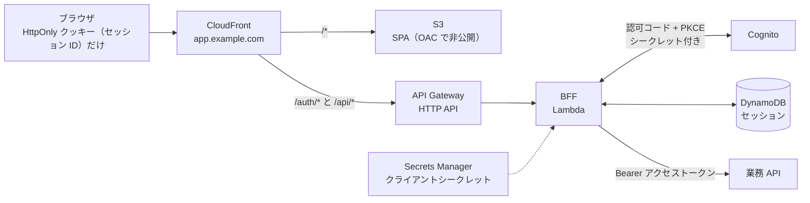
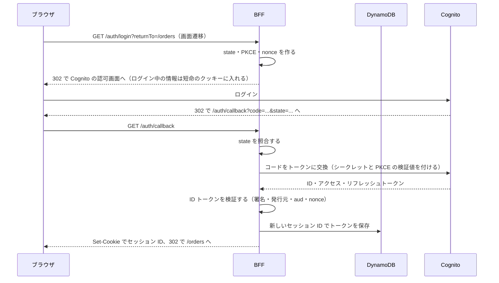
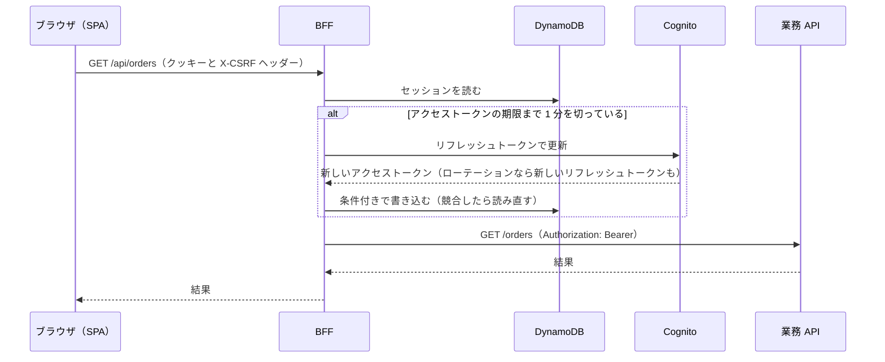
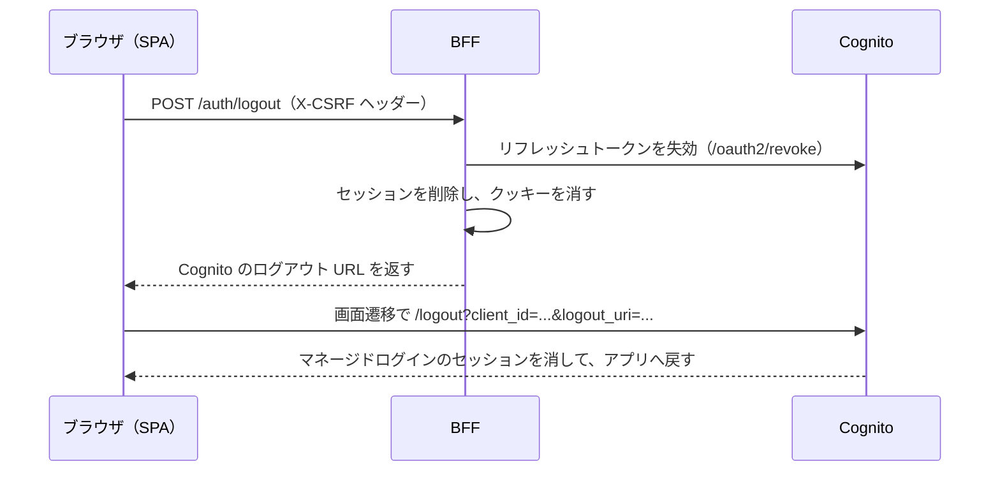
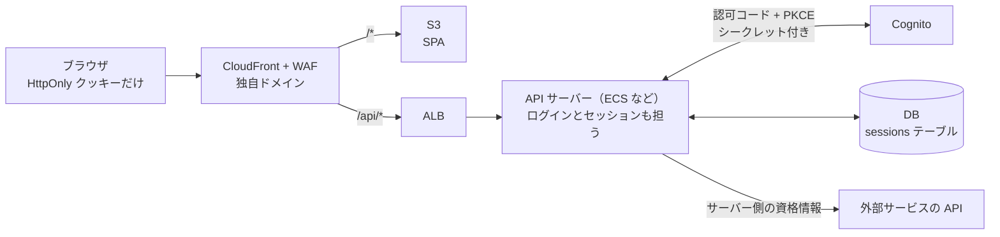
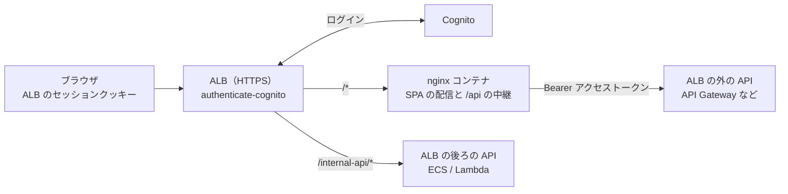
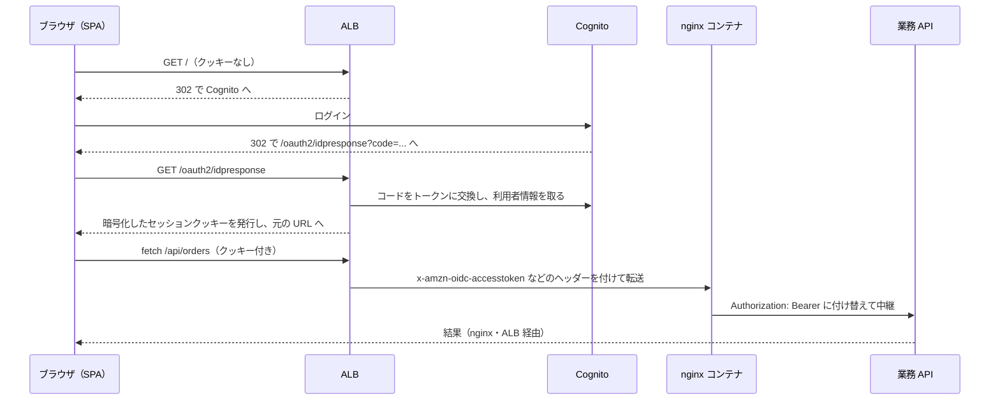

# Cognito ＋ SPA で BFF・ALB を使う（設定・流れ・注意点）

## 概要

[Cognito を使う SPA のトークンの扱いと構成の選び方](cognito-spa-auth.md) の B・B'・C の詳しい中身。
どれも「トークンをブラウザに置かず、ブラウザには HttpOnly クッキーだけを渡す」構成で、違いは**誰がログインとトークンの保持を担うか**。

| 案 | ログインとトークンの保持を担うもの |
|---|---|
| B. Lambda の BFF | CloudFront の後ろに置いた Lambda |
| B'. API サーバーが BFF を兼ねる | 既存の API サーバー（ECS などで動く Rails・Express など） |
| C. ALB の Cognito 認証 | ALB の機能（設定だけ） |

## 前提知識

- BFF（Backend for Frontend）の考え方: [SPA の認証構成パターン](../web-security/spa-auth-architecture.md)
- BFF を同じオリジンに置く理由: [オリジン・サイト・クッキー・CORS・CSRF](../web-security/origin-cookie-cors-csrf.md)
- 認可コードフロー・PKCE・機密クライアント: [OAuth 2.0 と OpenID Connect の基礎](../web-security/oauth-oidc-basics.md)
- Cognito と CloudFront の用語: [Cognito を使う SPA](cognito-spa-auth.md#前提知識)

ALB と、その他のサービスの用語:

| 用語 | 内容 |
|---|---|
| ALB のリスナー | ポートとプロトコル（HTTPS:443 など）ごとの受け口。証明書を付ける |
| ALB のルール | パスやホスト名の条件と、実行するアクションの組。優先度の順に評価する |
| ALB のアクション | `forward`（ターゲットへ送る）、`redirect`、`fixed-response`、`authenticate-cognito`（Cognito でログインさせる）など。1 つのルールに順番に並べられる |
| ターゲットグループ | リクエストの送り先（ECS のタスク、Lambda、IP など）のまとまり |
| API Gateway（HTTP API） | Lambda などの前に置く API の入口。JWT の検証もできる |
| DynamoDB の TTL | 項目に期限の時刻を入れておくと、自動で消してくれる機能。セッションの掃除に使う |
| Secrets Manager | クライアントシークレットなどの秘密の値の保管場所 |

## 3 つの比較

| 観点 | B. Lambda の BFF | B'. API サーバーが兼ねる | C. ALB の Cognito 認証 |
|---|---|---|---|
| 作るもの | ログイン・コールバック・更新・ログアウト・中継 | ログイン・コールバック・セッション管理（中継は不要） | ほぼ設定だけ。ログアウトと外部 API への中継だけ少し書く |
| トークンやセッションの場所 | DynamoDB | API サーバーの DB（または Redis など） | ALB の暗号化クッキー |
| 静的ファイル | S3 のまま | S3 のまま | ALB の後ろ（コンテナ）が扱いやすい。S3 のままでもできるが手間が増える |
| ログイン画面 | マネージドログイン | マネージドログイン。自前の画面も可（後述） | マネージドログインだけ |
| ログアウト時の失効 | できる | できる | アプリからはできない |
| 費用 | リクエスト課金 | 既存のサーバーの範囲 | ALB の時間料金（常時） |
| 向いている場合 | API がサーバーレス中心 | 既に API サーバーがある | 認証のコードを持ちたくない、社内向け |

---

## B. CloudFront ＋ Lambda の BFF

### 構成



### 設定

| 部品 | 設定 |
|---|---|
| Cognito のアプリクライアント | **シークレット付き**。認可コードフローだけを許可する。コールバック URL は `https://app.example.com/auth/callback`、サインアウト URL は `https://app.example.com/`。スコープは `openid` と API のカスタムスコープ。リフレッシュトークンのローテーションを有効にする |
| CloudFront | `/*` は S3（OAC）。`/auth/*` と `/api/*` はキャッシュを無効（`CachingDisabled`）にし、`Host` を除いてクッキー・ヘッダー・クエリを転送する |
| BFF の入口 | API Gateway の HTTP API がおすすめ。Lambda 関数 URL ＋ OAC だと、POST や PUT のときにブラウザが本文のハッシュ（`x-amz-content-sha256`）を付ける必要があり、SPA から使いにくい |
| オリジンの保護 | CloudFront からだけ受け付ける。CloudFront のカスタムヘッダーに秘密の値を入れ、BFF で確認する |
| DynamoDB | セッションのテーブル。TTL を有効にする |
| AWS WAF | CloudFront に付ける。ログインの口に回数制限 |

### ログインの流れ



- state・PKCE・nonce・ID トークンの検証は自分で書かず、OIDC のライブラリ（Node なら `openid-client`）に任せる
- **セッション ID はログインのたびに新しく作る**（ログイン前の ID を使い回すと、セッション固定攻撃を受ける）
- `returnTo` は同じオリジンの相対パスだけを許可する

### API 呼び出しとトークンの更新



```ts
// DynamoDB に保存するセッション 1 件
type Session = {
  sid: string; // パーティションキー。256 ビットの乱数
  sub: string;
  name: string;
  accessToken: string;
  refreshToken: string;
  accessTokenExpiresAt: number; // ミリ秒
  createdAt: number; // 絶対的な期限の判定用
  lastSeenAt: number; // 無操作の期限の判定用
  version: number; // 同時に更新されたときの競合を防ぐ
  ttl: number; // DynamoDB の TTL（秒）。リフレッシュトークンの期限に合わせる
};

// 期限が近ければ、リフレッシュトークンでアクセストークンを取り直す
async function ensureFreshToken(session: Session): Promise<Session> {
  if (session.accessTokenExpiresAt - Date.now() > 60_000) {
    return session;
  }
  const res = await fetch(`${COGNITO_DOMAIN}/oauth2/token`, {
    method: 'POST',
    headers: {
      'Content-Type': 'application/x-www-form-urlencoded',
      Authorization: `Basic ${btoa(`${CLIENT_ID}:${CLIENT_SECRET}`)}`,
    },
    body: new URLSearchParams({ grant_type: 'refresh_token', refresh_token: session.refreshToken }),
  });
  if (!res.ok) {
    // リフレッシュトークンの期限切れや失効。SPA には 401 を返してログインに誘導する
    throw new SessionExpiredError();
  }
  const tokens = await res.json();
  const updated: Session = {
    ...session,
    accessToken: tokens.access_token,
    // ローテーションが有効なら新しいリフレッシュトークンが返る
    refreshToken: tokens.refresh_token ?? session.refreshToken,
    accessTokenExpiresAt: Date.now() + tokens.expires_in * 1000,
    version: session.version + 1,
  };
  // version が変わっていなければ書き込む。別のリクエストが先に更新していたら、そちらを読み直して使う
  return await saveIfVersionMatches(updated, session.version);
}
```

- **同時に更新が走る問題**: ローテーションを有効にすると、画面が API を並行して呼んだときに、同じリフレッシュトークンで同時に更新しようとすることがある。条件付きで書き込み、負けた側は読み直す
- API からの `Set-Cookie` やホップ間のヘッダーは、ブラウザに中継しない
- Lambda の同期応答は 6 MB まで。ファイルのダウンロードは S3 の署名付き URL を返す

### ログアウト



Cognito の `/logout` まで行かないと、マネージドログインのセッションが残り、次に `/auth/login` を開いたときにパスワードを聞かれずにログインできてしまう。

### セッションの期限

| 期限 | 決め方の例 | 実装 |
|---|---|---|
| 無操作の期限 | 2 時間操作がなければ切る | `lastSeenAt` を見る |
| 絶対的な期限 | 最長 1 営業日（12 時間） | `createdAt` を見る。クッキーの `Max-Age`、DynamoDB の TTL、リフレッシュトークンの有効期間もそろえる |
| アクセストークン | 5〜15 分 | BFF が自動で更新するので、短くしても利用者は困らない |

### メリット・デメリット

| メリット | デメリット |
|---|---|
| トークンがブラウザに出ない | ログイン・更新・ログアウト・中継を自分で作り、保守する |
| S3 での配信をそのまま使える | OIDC の実装を間違えると穴になる（ライブラリを使う） |
| リクエスト課金で、利用が少なければ安い | Lambda の制約（応答サイズ、コールドスタート）がある |
| 失効やセッションの期限を細かく制御できる | BFF が止まるとすべての API 呼び出しが止まる |

### 注意点

- **トークンを返す口を作らない**。ログイン状態の確認用の `/auth/me` は、利用者の名前やロールだけを返す
- **ログにトークンやクッキーを出さない**
- 自作が不安なら、BFF の仕組みを持つ既製品も検討する（.NET の Duende BFF、Spring Cloud Gateway のトークン中継など）

---

## B'. API サーバーが BFF を兼ねる

すでに API サーバーがあり、CloudFront で `/api/*` をそこへ振り分けている構成なら、API サーバー自身にログインとセッションの管理を持たせるのがいちばん部品が少ない。

### 構成



ログインの流れは B と同じで、`/auth/login` と `/auth/callback` を API サーバーの `/api/auth/login`・`/api/auth/callback` に置き換える。

### ポイント

- **Cognito のトークンは、ログインの確認だけに使えば足りることが多い**。外部サービスの API をサーバー自身の資格情報で呼んでいるなら、ログイン後は利用者の Cognito トークンが要らない。ID トークンを検証して会員を特定したら、以降は API サーバーのセッションだけで動かせる
- **リフレッシュトークンを保持するのは、必要なときだけ**。利用者本人の権限で Cognito の API を呼ぶ処理（パスワードの変更など）がある場合は、DB に暗号化して保存する。管理者向けの API（`AdminUserGlobalSignOut` など）は IAM の権限で呼べるので、利用者のトークンは要らない
- **セッションは DB（または Redis など）に置く**。Cognito のトークンをフレームワークの暗号化クッキーに直接入れると、クッキーの上限（約 4KB）を超えやすい。「DB のセッションテーブル ＋ セッション ID だけのクッキー」にする
- **セッションの期限は API サーバーで決める**。パスワードの変更・退会・利用停止のときは、その利用者のセッションをすべて消す
- **API 専用の設定のフレームワークでは、クッキーと CSRF 対策が外れていることがある**。たとえば Rails の API モードはクッキーのミドルウェアを含まないので、`ActionDispatch::Cookies` を足し、コントローラーに `ActionController::Cookies` を含める。CSRF 対策も標準のものが使えないので、独自ヘッダー（`X-CSRF: 1`）か `Origin` を確認する処理を入れる

Rails でセッション ID のクッキーを発行する例:

```ruby
# ログイン完了時（コールバック）。セッション ID はログインのたびに新しく作る
record = user.sessions.create!(user_agent: request.user_agent, ip_address: request.remote_ip)
cookies.signed["__Host-session_id"] = {
  value: record.id,
  httponly: true,
  secure: true,
  same_site: :lax,
  path: "/",
  expires: 12.hours.from_now
}
```

### 自前のログイン画面を使いたい場合

マネージドログインではなく、SPA の中にログイン画面を作りたい場合は、API サーバーが Cognito の API（`InitiateAuth`・`RespondToAuthChallenge`）を代わりに呼ぶ形にできる。MFA のやり取りも API サーバーが中継する。

| 注意点 | 内容 |
|---|---|
| パスワードが API サーバーを通る | 自社のサーバーなので許容範囲だが、ログに出さない |
| Cognito からはサーバーの IP に見える | すべてのログインが NAT Gateway などの IP から来たように見え、脅威保護（不審なログインの検知）や IP ごとの制限が正しく働かない。ブラウザで集めた情報と利用者の IP（`UserContextData` など）を Cognito に渡す |
| シークレット付きのアプリクライアント | API の呼び出しにシークレットから計算した値（`SECRET_HASH`）が必要 |

### ALB の後ろに API サーバー以外のサービスがある場合

ALB からパスで Lambda などにも振り分けていて、それも利用者の認証が要る場合は、**認証の入口を API サーバーに一本化**するのがおすすめ。ブラウザからは API サーバーだけを呼び、API サーバーが IAM の権限で Lambda などを呼ぶ。
Lambda 側でもセッションを確かめる形にすると、セッションの検証が 2 か所に分かれ、Lambda から DB へ届く経路も必要になる。

### メリット・デメリット

| メリット | デメリット |
|---|---|
| 部品が増えない（API サーバーと DB を使い回す） | API サーバーにログイン・セッション・CSRF 対策の処理を足す |
| CloudFront で同じオリジンがすでにできていれば、構成を変えずに済む | API サーバーが止まると、ログインもできなくなる |
| 認証の入口が 1 か所にまとまり、権限の判断も API サーバーの中で完結する | 後ろに別のサービスがあると、そこへの認証の渡し方を決める必要がある |
| ログイン後は Cognito のトークンを持たない設計にもでき、漏れるものが減る | 自前のログイン画面にすると、脅威保護などへの配慮が要る |

---

## C. ALB の Cognito 認証

### 構成



ALB がログイン・トークンの保持・更新を引き受け、後ろのサーバーに利用者の情報とアクセストークンをヘッダーで渡す。
ブラウザにトークンを返すエンドポイントが無いので、トークンが JS に渡ることはない。

### 設定

ALB の HTTPS リスナーのルールに、「`authenticate-cognito` → `forward`」の順でアクションを並べる。

| 項目 | 設定 | 理由 |
|---|---|---|
| リスナー | HTTPS（ACM の証明書） | 認証のアクションは HTTPS でしか使えない |
| アプリクライアント | **シークレット付き**。認可コードフロー。コールバック URL は `https://app.example.com/oauth2/idpresponse` | ALB が決めているコールバックのパス |
| スコープ | `openid` と API のカスタムスコープ | API 向けのアクセストークンにスコープを入れる |
| セッションの期限（`SessionTimeout`） | 業務に合わせる（例: 12 時間）。既定は 7 日 | ログインしたままでいられる期間 |
| 未認証のとき（画面のルール） | `authenticate`（Cognito へリダイレクト） | 画面を開いたらログインさせる |
| 未認証のとき（API のルール） | **`deny`**（401 を返す） | `fetch` がリダイレクトを受けると CORS エラーになり、SPA で判別できないため |
| ターゲットのセキュリティグループ | ALB からの通信だけを許可する | ALB を迂回してヘッダーを偽装されないようにする |

### 流れ



ALB がターゲットに付けるヘッダー:

| ヘッダー | 中身 | 使い方 |
|---|---|---|
| `x-amzn-oidc-accesstoken` | Cognito のアクセストークン（そのまま） | API に Bearer で渡す |
| `x-amzn-oidc-identity` | 利用者の ID（`sub`） | ログなど |
| `x-amzn-oidc-data` | 利用者情報（ALB が署名した JWT） | 利用者を識別するなら、署名と `signer`（自分の ALB の ARN）を検証してから使う |

### ALB の外の API を呼ぶ場合（nginx で中継）

ALB は自分のターゲットにしかリクエストを送れない。API Gateway など ALB の外にある API を呼ぶには、ターゲットの nginx で中継する。

```nginx
location /api/ {
    # ALB の /api/* ルールは deny なので、ここに来るのはログイン済みのリクエストだけ
    if ($http_x_amzn_oidc_accesstoken = "") {
        return 401;
    }
    if ($http_x_csrf != "1") {
        return 403;
    }
    # アクセストークンを Bearer に付け替え、ALB のヘッダーとクッキーは渡さない
    proxy_set_header Authorization "Bearer $http_x_amzn_oidc_accesstoken";
    proxy_set_header X-Amzn-Oidc-Accesstoken "";
    proxy_set_header X-Amzn-Oidc-Data "";
    proxy_set_header X-Amzn-Oidc-Identity "";
    proxy_set_header Cookie "";
    proxy_set_header Host ${API_HOST};
    proxy_ssl_server_name on;
    proxy_pass https://${API_HOST}/;
}
```

利用者の名前などを画面に出したい場合は、API 側に `/me` を用意する（nginx で JWT を読むのは手間がかかる）。

### SPA を S3 から配信したまま ALB の認証を使う場合

画面（`/*`）が ALB を通らないので、次の手間が増える。

- ログインを始めるための、ALB を通るパスを用意する（例: `/api/auth/login` のルールを `authenticate` にし、ログイン後に `/` へリダイレクトする）
- CloudFront から ALB へ `Host` ヘッダーを転送し、ALB に独自ドメインの証明書を付ける（ALB はコールバック URL をリクエストのホスト名から作るため）
- `/oauth2/idpresponse` を ALB へ振り分けるビヘイビアを CloudFront に足す

手間を避けたいなら、画面も nginx のコンテナで ALB の後ろから配信するほうが素直。

### セッション切れとログアウト

- **セッション切れ**: `/api/*` が 401 を返したら、SPA は画面を開き直す（`location.reload()`）。画面のルールは `authenticate` なので、ALB が Cognito へ誘導し、ログイン後に元の URL へ戻す
- **ログアウト**: ALB にはログアウトの機能が無いので、アプリで次の 2 つを行う
  1. ターゲットの応答で、ALB のセッションクッキーを期限切れにして消す（大きいと `-0`・`-1` のように分割されるので、すべて消す）
  2. Cognito の `/logout` へリダイレクトする（マネージドログインのセッションも消す）
- **トークンの失効**: リフレッシュトークンは ALB が持っているので、アプリからは失効できない。必要なら、バックエンドから管理 API（`AdminUserGlobalSignOut`）でその利用者のトークンをまとめて失効させる

### メリット・デメリット

| メリット | デメリット |
|---|---|
| 認証のコードがほぼ要らず、OIDC の実装ミスが起きない | ALB の時間料金がずっとかかる |
| トークンをブラウザに返す口が無い | ログイン画面はマネージドログインだけ |
| 後ろのサーバーが ECS でも Lambda でも同じヘッダーを受け取れる | ログアウトに手間がかかり、リフレッシュトークンを失効できない |
| internal ALB にして閉域で使える | SPA を S3 から配信していると、追加の設定が要る |

### 注意点

- **internal ALB でも外向きの通信が必要**。ALB 自身が Cognito のトークン取得や利用者情報の取得の口を呼ぶので、外へ出る経路（NAT Gateway など）が要る
- **CSRF 対策は ALB がしてくれない**。上の nginx のように、独自ヘッダーを必須にする
- **確認してから使う点**: トークンの自動更新の動きと、セッションクッキーの属性（HttpOnly など）は、最新のドキュメントと実機で確かめる

---

## CloudFront で SPA と API を同じオリジンにするときの注意点

B・B'（と、CloudFront を前に置く C）で共通の注意点。

| 注意点 | 起きること | 対策 |
|---|---|---|
| **カスタムエラーページ** | SPA のために「403 や 404 のときは `/index.html` を 200 で返す」と設定すると、ディストリビューション全体に効き、**API の 403 や 404 まで `index.html` の 200 に置き換わる** | エラーページの設定は使わず、S3 のビヘイビアだけに CloudFront Functions を付けて、拡張子の無いパスを `/index.html` に書き換える（下のコード） |
| **キャッシュ** | `/api/*` のキャッシュ設定を間違えると、ある利用者の応答が別の利用者に返る | `/api/*` は `CachingDisabled`。API も個人の情報には `Cache-Control: no-store` を返す |
| **ALB への直接アクセス** | CloudFront を迂回されると WAF も効かない | VPC オリジンで ALB をプライベートサブネットに置く。または、セキュリティグループで CloudFront のマネージドプレフィックスリストだけを許可し、カスタムヘッダーの秘密の値も ALB のルールで確認する |
| **利用者の IP** | API サーバーから見ると、送信元が CloudFront や ALB になる | `CloudFront-Viewer-Address` ヘッダーを転送して使うか、信頼するプロキシを設定する（セッションの記録や回数制限に必要） |
| **応答時間の上限** | CloudFront がオリジンの応答を待つのは既定で 30 秒 | 長い処理は非同期にする（EventBridge・Step Functions・SQS など） |
| **WAF のルール** | 静的ファイルと API で必要なルールが違う | パスで範囲を絞ったルールにする（ログインの口だけ回数制限を厳しくする、など） |
| **ログ** | CloudFront の標準ログでクッキーの記録を有効にすると、セッション ID がログに残る | クッキーの記録は無効のままにする |

SPA のルーティング用の CloudFront Functions（S3 の `/*` のビヘイビアだけに付ける）:

```js
// 拡張子の無いパス（/orders/123 など）は SPA の index.html を返す。/api/* には付けない
function handler(event) {
  var request = event.request;
  if (request.uri.indexOf('.') === -1) {
    request.uri = '/index.html';
  }
  return request;
}
```

同じオリジンに置くのは SPA と API だけにする。利用者がアップロードしたファイルや、別のチームが更新するページ（キャンペーンページ・CMS など）は別のオリジンから配信する（[SPA の認証構成パターン](../web-security/spa-auth-architecture.md#api-を同じオリジンに置くか分けるか)）。

## SPA 側の実装

B・B'・C のどれでも、SPA から見た形は同じになる。

- API は相対パス（`/api/...`）で呼び、`X-CSRF: 1` ヘッダーを付ける
- トークンの更新処理は持たない（BFF・API サーバー・ALB が行う）
- 401 が返ったらログインに誘導する（B・B' は `/api/auth/login?returnTo=...` へ画面遷移、C は画面を開き直す）
- 起動時にログイン状態を確認する間は「読み込み中」を表示し、ログイン画面が一瞬見えるのを防ぐ

## 確認が必要な点

- ALB の Cognito 認証で、アクセストークンの期限が切れたときの更新の動きと、セッションクッキーの属性
- Cognito のリフレッシュトークンのローテーションの猶予期間
- CloudFront のオリジンの応答時間の上限を引き上げられる範囲

## 参考

- [Application Load Balancer でユーザーを認証する](https://docs.aws.amazon.com/elasticloadbalancing/latest/application/listener-authenticate-users.html)
- [Amazon Cognito: ユーザープールのトークンを使う](https://docs.aws.amazon.com/cognito/latest/developerguide/amazon-cognito-user-pools-using-tokens-with-identity-providers.html)
