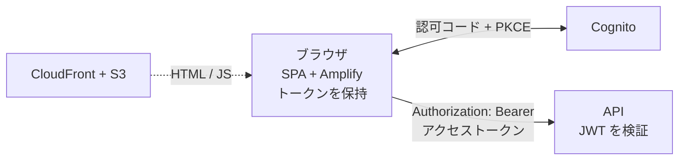

# Cognito を使う SPA のトークンの扱いと構成の選び方

## 概要

Amazon Cognito のユーザープールで利用者を認証し、SPA を S3（CloudFront 経由）で配信する構成で、トークンをどこに持たせるかの整理。
よくある構成の選択肢と、それぞれのメリット・デメリット、どの場合にどれを選ぶかをまとめる。

結論:

- **できればトークンをブラウザに置かない**。CloudFront で SPA と API を同じオリジンにまとめ、BFF（API サーバーか Lambda）がトークンかセッションを持つ。ブラウザには HttpOnly クッキーだけを渡す
- **Cognito の SPA 向けライブラリ（Amplify）は、何も設定しないとトークンを localStorage に保存する**。リフレッシュトークンの既定の有効期間も 30 日と長い。SPA だけで完結させるなら、この 2 つを必ず見直す
- XSS が起きれば、どの構成でもその場で API を呼ばれる。トークンの置き場所で防げるのは持ち出しまでで、XSS そのものの対策（CSP・出力時のエスケープ）が先

関連:

- 詳細: [BFF と ALB の Cognito 認証（設定・流れ・注意点）](bff-and-alb-auth.md)
- 前提知識: [OAuth 2.0 と OpenID Connect の基礎](../web-security/oauth-oidc-basics.md)、[オリジン・サイト・クッキー・CORS・CSRF](../web-security/origin-cookie-cors-csrf.md)
- 一般論: [SPA のトークンの置き場所](../web-security/spa-token-storage.md)、[SPA の認証構成パターン](../web-security/spa-auth-architecture.md)、[XSS](../web-security/xss.md)

## 前提知識

### Cognito の構成要素

| 要素 | 内容 |
|---|---|
| ユーザープール | 利用者の台帳と認証の機能。OIDC の認可サーバー（IdP）として動く |
| アプリクライアント | ユーザープールを使うアプリごとの設定。シークレット無し（公開クライアント、SPA 向け）とシークレット付き（機密クライアント、サーバー向け）がある。許可するフロー、コールバック URL、トークンの有効期間もここで決める |
| マネージドログイン | Cognito が用意するログイン画面（旧ホスト型 UI）。ブランドに合わせてデザインを調整できる。サインアップ・MFA・パスワードの再設定も含む |
| ドメイン | マネージドログインと OAuth のエンドポイント（`/oauth2/authorize`・`/oauth2/token` など）を公開するドメイン。独自ドメインも使える |
| リソースサーバーとカスタムスコープ | API ごとのスコープ（例: `orders/read`）を定義する。アクセストークンに入る |
| Lambda トリガー | サインアップ前やトークン発行前などに独自の処理を差し込む |
| 脅威保護 | 漏えいしたパスワードの検知や、不審なログインに応じた追加認証 |
| ID プール | 利用者に AWS の一時的な資格情報を渡す仕組み。ブラウザに AWS の資格情報を持たせることになるので、S3 や DynamoDB をブラウザから直接触る必要がある場合だけ使う |

### Cognito のトークン

| トークン | 用途 | 既定の有効期間 | 設定できる範囲 |
|---|---|---|---|
| ID トークン | ログインした人の情報。クライアントが使う | 60 分 | 5 分〜1 日 |
| アクセストークン | API を呼ぶ。スコープが入る | 60 分 | 5 分〜1 日 |
| リフレッシュトークン | トークンの取り直し | **30 日** | 60 分〜10 年 |

### 押さえておく性質

| 性質 | 影響 |
|---|---|
| Amplify の保存先は既定で **localStorage** | 何もしないと、いちばん持ち出されやすい場所に置かれる |
| Amplify の `CookieStorage` は **HttpOnly ではない**（JS が書き込むクッキー） | 名前に反して、XSS への耐性は localStorage と変わらない。SSR のフレームワークでサーバーとトークンを共有するための機能 |
| アクセストークンには `aud` が無く、`client_id` と `token_use` が入る | API は `token_use` が `access` であること、`client_id`、発行元、期限、スコープを確かめる。ID トークンで API を呼ばない |
| ログアウト時の失効（`RevokeToken`、グローバルサインアウト）はリフレッシュトークンに効く | API Gateway の JWT オーソライザーのように署名と期限だけを見る検証では、失効させたアクセストークンも期限までは通る。**アクセストークンの有効期間を短くする**ことが重要 |
| リフレッシュトークンのローテーション | 2025 年に追加された（使える機能プランは要確認）。ブラウザにリフレッシュトークンを持たせるなら有効にする |
| マネージドログインのセッション | マネージドログインは自分のドメインにセッションクッキーを持ち、その間は再ログインなしで戻ってこられる。長さは既定で 1 時間程度（要確認） |
| AWS WAF | ユーザープールにも関連付けられる。ログインやトークン取得の口に、IP 制限や回数制限を掛けられる |

### CloudFront の用語

どの構成でも CloudFront を使うので、設定に出てくる用語をまとめておく。

| 用語 | 内容 |
|---|---|
| ディストリビューション | CloudFront の設定の単位。独自ドメインと証明書を付ける |
| オリジン | CloudFront の後ろにある配信元（S3、ALB、API Gateway、Lambda 関数 URL など） |
| ビヘイビア | パス（`/*`、`/api/*` など）ごとに、どのオリジンへ送り、どうキャッシュするかを決めるルール |
| OAC（オリジンアクセスコントロール） | S3 などを CloudFront からだけ読めるようにする仕組み |
| キャッシュポリシー | キャッシュするか、何をキャッシュのキーにするか。API には `CachingDisabled` を使う |
| オリジンリクエストポリシー | クッキー・ヘッダー・クエリのうち、何をオリジンへ転送するか |
| レスポンスヘッダーポリシー | 応答にヘッダー（CSP など）を付ける |
| CloudFront Functions | リクエストや応答を軽く書き換える小さな関数（パスの書き換えなど） |
| VPC オリジン | プライベートサブネットにある ALB などを、インターネットに公開せずにオリジンにする仕組み（2024 年に追加） |

## 構成の選択肢

| 案 | 構成 | トークン・セッションの場所 | 詳細 |
|---|---|---|---|
| A. SPA で完結 | S3 ＋ CloudFront。SPA が Amplify などで Cognito に直接ログインする | ブラウザ（localStorage・sessionStorage・メモリ） | このページの下 |
| B. Lambda の BFF | CloudFront で `/api/*` と `/auth/*` を Lambda の BFF に送る | DynamoDB（サーバー側） | [BFF と ALB](bff-and-alb-auth.md#b-cloudfront--lambda-の-bff) |
| B'. API サーバーが BFF を兼ねる | CloudFront で `/api/*` を ALB → API サーバー（ECS など）に送り、API サーバーがログインとセッションも担う | API サーバーの DB（サーバー側） | [BFF と ALB](bff-and-alb-auth.md#b-api-サーバーが-bff-を兼ねる) |
| C. ALB の Cognito 認証 | ALB がログインとトークンの保持を担い、後ろのサーバーにヘッダーで渡す | ALB が発行する暗号化クッキー | [BFF と ALB](bff-and-alb-auth.md#c-alb-の-cognito-認証) |

### メリットとデメリット

| 案 | メリット | デメリット |
|---|---|---|
| A. SPA で完結 | サーバーが要らず、いちばん単純。Amplify の部品でログイン画面も作りやすい | トークンがブラウザにあり、XSS で持ち出される。公開クライアントなので、リフレッシュトークンを盗まれるとそれだけで使われる。ブラウザを閉じても保持するには localStorage が必要になる |
| B. Lambda の BFF | トークンがブラウザに出ない。S3 での配信をそのまま使える。リクエスト課金で、利用が少なければ安い。失効やセッションの期限を細かく制御できる | ログイン・コールバック・更新・ログアウト・中継を自分で作る。OIDC の実装を間違えると穴になる。Lambda の応答サイズ（6 MB）などの制約がある |
| B'. API サーバーが BFF を兼ねる | 部品が増えない。セッションを既存の DB に置ける。認証の入口が API サーバー 1 か所にまとまる | API サーバーにクッキーとセッションの処理を足す（API 専用のフレームワーク設定だと、クッキーや CSRF 対策が外れていることがある）。後ろに別のサービスがあると、そこへの認証の渡し方を決める必要がある |
| C. ALB の Cognito 認証 | 認証のコードがほぼ要らない。トークンをブラウザに返す口が無い。後ろのサーバーが ECS でも Lambda でも同じヘッダーを受け取れる | ALB の固定費がかかる。ログイン画面はマネージドログインになる。ALB が持つリフレッシュトークンをアプリから失効できない。SPA を S3 から配信していると、ALB を通らない画面のためにログイン開始用のパスなどを用意する手間がある |

## 選び方

| 状況 | おすすめ | 理由 |
|---|---|---|
| すでに API サーバーがあり、CloudFront で `/api/*` をそこへ振り分けている | **B'** | 同じオリジンがすでにできている。部品を増やさずにトークンをブラウザから消せる |
| 一般公開で、ポイント・決済・個人情報など、盗まれたときの被害が大きい操作がある | **B' か B** | トークンを持ち出させない。重要な操作では MFA で本人確認をし直す（ステップアップ認証）も組み合わせる |
| API がサーバーレス（API Gateway ＋ Lambda）中心で、S3 での配信を続けたい | **B** | 常時かかる費用を抑えつつ、トークンをサーバー側に置ける |
| 社内向けで、VPC の中に ALB を置き、コンテナで画面も配信できる | **C** | 設定だけで済み、OIDC の実装ミスが起きない |
| 認証のコードを書ける人がいない、作り込みたくない | **C** | 同上 |
| サーバーを置けない、試作、扱うデータのリスクが低い | **A**（下の対策をすべて入れる） | 構成が単純。代わりに被害を小さくする設定を必ず入れる |
| モバイルアプリや外部の提携先も同じ API を使う | Web は **B' か B**、それ以外はトークン | クッキーはブラウザ向けの仕組み。モバイルは認可コード ＋ PKCE でトークンを使い、API の入口を分ける（[SPA の認証構成パターン](../web-security/spa-auth-architecture.md#api-を同じオリジンに置くか分けるか)） |

## A. SPA で完結させる場合の対策



- **アプリクライアント**: シークレット無しにし、認可コード ＋ PKCE だけを許可する。インプリシットフローは無効にする
- **保存先**: Amplify の保存先を sessionStorage かメモリに変える

  ```ts
  import { Amplify } from 'aws-amplify';
  import { cognitoUserPoolsTokenProvider } from 'aws-amplify/auth/cognito';
  import { sessionStorage } from 'aws-amplify/utils';

  Amplify.configure(config);
  // 既定の localStorage ではなく sessionStorage に保存する
  cognitoUserPoolsTokenProvider.setKeyValueStorage(sessionStorage);
  ```

  メモリに置く場合は、`setItem`・`getItem`・`removeItem`・`clear` を `Map` で実装したものを渡す
- **有効期間**: アクセストークンは 5〜15 分、リフレッシュトークンは業務に合わせて数時間〜1 日程度にし、ローテーションを有効にする
- **ログアウト**: リフレッシュトークンを失効させる（Amplify の `signOut` のグローバルサインアウト）
- **CSP**: CloudFront のレスポンスヘッダーポリシーで付ける。`connect-src` には Cognito のドメインと API のドメインを入れる
- **API 側**: アクセストークンを受け取り、`token_use`・`client_id`・発行元・期限・スコープを検証する。API Gateway なら HTTP API の JWT オーソライザーで検証できる
- **AWS WAF**: ユーザープールと API に関連付け、ログインの口に回数制限、社内向けなら IP 制限を掛ける

## ログイン状態の保持

リロードやブラウザの再起動の後もログインしたままにしたい場合の整理。一般論は [SPA のトークンの置き場所](../web-security/spa-token-storage.md#ログイン状態をどこまで保持するか) を参照。

| やりたいこと | 方法 | 注意 |
|---|---|---|
| リロードで消えなければよい | A で Amplify の保存先を sessionStorage にする | sessionStorage はリロードでは消えない。新しいタブでは消える |
| タブやブラウザを閉じても保持し、持ち出しも防ぎたい | B・B'・C のクッキーで保持する | B・B' はクッキーの `Max-Age` とサーバー側のセッションの期限、C は ALB の `SessionTimeout`（既定 7 日）で長さを決める |
| サーバーを置かずに、ブラウザを閉じても保持したい | A で localStorage に置く | リフレッシュトークンを短くし、ローテーション・IP 制限・CSP を必ず入れる |
| トークンをメモリだけに置き、リロードのたびに取り直したい | 起動時に Cognito の認可画面へリダイレクトし、マネージドログインのセッションで戻ってくる | リロードのたびに画面遷移が 1 往復入る。マネージドログインのセッションが切れると再ログインになる。iframe で画面を出さずに取り直す方法は、サードパーティクッキーのブロックで動かないことがある |

「ログインしたままでいられる期間」は、盗まれたときに使われ続ける期間でもある。業務で必要な長さ（多くは 1 営業日）を先に決めてから、有効期間を設定する。

## どの構成でも確認すること

- **CSP** を SPA の応答に付ける（CloudFront のレスポンスヘッダーポリシー）
- **AWS WAF** を CloudFront とユーザープールに付ける
- **API にはアクセストークンを使う**。ID トークンで API を呼ばない
- **外部サービスの API キーなどはブラウザに出さない**。Secrets Manager に置き、サーバーから呼ぶ
- CloudFront で SPA と API を同じオリジンにする場合の注意点（エラーページの設定・キャッシュ・ALB への直接アクセスなど）は [BFF と ALB](bff-and-alb-auth.md#cloudfront-で-spa-と-api-を同じオリジンにするときの注意点) を参照

## 確認が必要な点

使う前に、最新のドキュメントか実機で確かめる。

- リフレッシュトークンのローテーションを使える機能プランと、猶予期間の設定
- マネージドログインのセッションの長さ
- AWS WAF をユーザープールに関連付けたとき、どのエンドポイントが対象になるか

## 参考

- [Amazon Cognito: ユーザープールのトークンを使う](https://docs.aws.amazon.com/cognito/latest/developerguide/amazon-cognito-user-pools-using-tokens-with-identity-providers.html)
- [Application Load Balancer でユーザーを認証する](https://docs.aws.amazon.com/elasticloadbalancing/latest/application/listener-authenticate-users.html)
