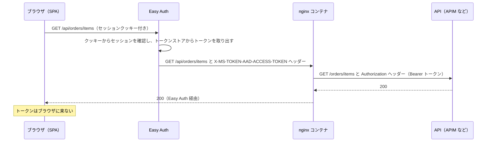

# App Service の Easy Auth と nginx でトークンを中継する

## 概要

App Service の組み込み認証（Easy Auth）でログインした SPA から、API Management（APIM）などで保護された API を呼ぶときのトークンの扱い。
SPA の Docker コンテナ（nginx）で `/api` を中継し、**トークンをブラウザの JS に一切渡さない**形にする。

結論:

- SPA は `/api/...` を相対パスで呼ぶだけ。ドメインもトークンも扱わない
- Easy Auth がトークンを保持・更新し、コンテナへのリクエストにヘッダーで付けて渡す。nginx がそれを `Authorization: Bearer` に付け替えて API へ中継する
- そのままだと `/.auth/me` から JS でトークンを取れてしまうので、**Front Door の WAF で `/.auth/me` を遮断**して初めて BFF と同等になる

関連:

- [SPA の認証構成パターン](../web-security/spa-auth-architecture.md)
- [社内共通 UI ライブラリへの認証の組み込み](internal-spa-platform-auth.md)
- lab での検証: [lab/AppService_AcceccToken](../../lab/AppService_AcceccToken/README.md)（比較ドキュメントでも 1 位は nginx のリバースプロキシ。ここではそれに `/.auth/me` の遮断を加えた）

## 流れ



- ブラウザから見ると、通信先は SPA を配信しているのと同じオリジンだけ。CORS は不要で、クッキーも自動で付く
- `/.auth/*`（ログイン・トークン更新など）は Easy Auth がコンテナより手前で処理する。nginx には届かないので、nginx の設定に書く必要はない
- 中継が動くのは、Easy Auth のトークンストアを有効にしているときだけ

## トークンの扱い方の案の比較

| 案 | 内容 | XSS での持ち出し | 負荷 | 評価 |
|---|---|---|---|---|
| 1. localStorage | `/.auth/me` のトークンを保存して使う | 読むだけで取れる。タブを閉じても残る | 少ない | 避ける |
| 2. 毎回取得 | API を呼ぶたびに `/.auth/me` から取る | `/.auth/me` を呼べば取れる | API 呼び出しが倍になり、Easy Auth の負荷も増える | 避ける |
| 3. メモリ（`ref`） | 取ったトークンを変数に持つ | `/.auth/me` を呼べば取れる | 少ない（リロードで取り直す） | ブラウザで持つなら妥協案 |
| 4. sessionStorage | タブ単位で保存する | 読むだけで取れる（タブを閉じれば消える） | 少ない | 3 とほぼ同じ |
| 5. HttpOnly クッキー | — | — | — | Easy Auth のセッションクッキーがすでに HttpOnly。APIM には直接送れないので、実現するには 6 の中継が要る |
| 6. nginx で中継 | トークンは JS に来ない | `/.auth/me` が開いていれば取れる | 少ない | 推奨 |
| 6 ＋ `/.auth/me` の遮断 | 同上 | **取れない** | 少ない | **最も推奨** |

1〜4 は、`/.auth/me` が開いている限り、XSS での持ち出しという点ではほぼ同じ。違いは「ストレージを読むだけの汎用的な攻撃コードで取られるか」と「ブラウザに残るか」。

6 に移行すると、セキュリティ以外にも次の利点がある。

- CORS の設定が要らなくなる（事前確認の OPTIONS も無くなる）
- 起動時に JS を書き換えて環境を切り替える処理が無くなる（後述）
- トークンの更新処理が単純になる（401 のときだけ）
- 開発者がトークンに触れなくなり、ログやコピーでうっかり漏らす経路が無くなる

## Easy Auth の設定

| 項目 | 値 | 理由 |
|---|---|---|
| 認証されていない要求 | 匿名を許可（AllowAnonymous） | ログインへの誘導は SPA が行う。「ログインページへリダイレクト」にすると、セッション切れ後の `fetch` が IdP への 302 を受けて CORS エラーになり、SPA で原因を判別できない |
| トークンストア | 有効 | nginx にトークンを渡すのに必要 |
| `loginParameters` | `scope=openid profile email offline_access api://<APIのクライアントID>/user_impersonation` | API 向けのアクセストークンと、更新用のリフレッシュトークンを受け取る |
| HTTPS のみ | 有効 | |
| クライアントシークレット | 使えるなら、マネージド ID をフェデレーション資格情報にする | シークレットの期限切れ対応をなくせる（対応状況は要確認） |
| アプリ設定 `API_HOST` | API のホスト名 | nginx の中継先 |

匿名を許可にすると、ログインしていない人にも静的ファイルは返る。ただし `/api` は nginx（トークンの有無）と API 側（トークンの検証）の 2 か所で守られていて、JS のバンドル自体は秘密ではないので、通常は問題ない。

## nginx の設定

公式の nginx イメージは、`/etc/nginx/templates/*.template` に置いたファイルの `${環境変数}` を起動時に値へ置き換える。
`$http_...` のような nginx の変数は置き換えられない（定義済みの環境変数だけを置き換えるため）。

```nginx
# /etc/nginx/snippets/security-headers.conf
# nginx は location に add_header があると server の add_header を引き継がないため、
# 各 location でこのファイルを include する
add_header Content-Security-Policy "default-src 'self'; script-src 'self'; connect-src 'self'; img-src 'self' data:; style-src 'self' 'unsafe-inline'; object-src 'none'; base-uri 'none'; frame-ancestors 'none'" always;
add_header X-Content-Type-Options "nosniff" always;
```

```nginx
# /etc/nginx/templates/default.conf.template
# 起動時に ${API_HOST} が App Service のアプリ設定の値に置き換わる
server {
    listen 80;
    root /usr/share/nginx/html;

    # 画面。index.html は毎回確認させ、ハッシュ付きのファイルは長くキャッシュする
    location / {
        include snippets/security-headers.conf;
        add_header Cache-Control "no-cache" always;
        try_files $uri /index.html;
    }
    location /assets/ {
        include snippets/security-headers.conf;
        add_header Cache-Control "public, max-age=31536000, immutable" always;
    }

    # 利用者情報。Easy Auth が付けたヘッダー（Base64 の JSON）をそのまま返す。
    # /.auth/me と違い、トークンは含まれない
    location = /_platform/me {
        include snippets/security-headers.conf;
        add_header Cache-Control "no-store" always;
        if ($http_x_ms_client_principal = "") {
            return 401;
        }
        default_type text/plain;
        return 200 $http_x_ms_client_principal;
    }

    location /api/ {
        include snippets/security-headers.conf;
        # 未ログインなら中継しない
        if ($http_x_ms_token_aad_access_token = "") {
            return 401;
        }
        # CSRF 対策。ライブラリ経由の呼び出しにだけ付くヘッダーを必須にする
        if ($http_x_csrf != "1") {
            return 403;
        }

        # アクセストークンを Bearer に付け替え、それ以外のトークンとクッキーは渡さない
        proxy_set_header Authorization "Bearer $http_x_ms_token_aad_access_token";
        proxy_set_header X-MS-TOKEN-AAD-ACCESS-TOKEN "";
        proxy_set_header X-MS-TOKEN-AAD-REFRESH-TOKEN "";
        proxy_set_header X-MS-TOKEN-AAD-ID-TOKEN "";
        proxy_set_header Cookie "";
        # App Service や APIM はホスト名で振り分けるので、Host と SNI を中継先に合わせる
        proxy_set_header Host ${API_HOST};
        proxy_ssl_server_name on;
        # 末尾の / で /api/ を取り除く（/api/orders/items → https://API_HOST/orders/items）
        proxy_pass https://${API_HOST}/;
    }
}
```

- 中継先のパスが `/api/...` のままでよいなら、`proxy_pass https://${API_HOST};` のように末尾の `/` を外す
- ログの書式（`log_format`）にヘッダーの値を入れない
- nginx は `proxy_pass` に直接書いたホスト名を**起動時にだけ** DNS で引く。中継先の IP が変わる可能性が気になる場合は、`resolver` と変数で毎回引く形にする（その場合、`/api` の除去は `rewrite` で行う）

## 環境ごとの切り替え（同じイメージで複数環境）

よくある「起動時にビルド済みの JS を書き換えて API のドメインを差し込む」方式は、中継にすると不要になる。

| | JS を書き換える方式 | 中継する方式 |
|---|---|---|
| 置き換える対象 | ビルド済みの JS ファイル | nginx の設定テンプレート |
| 仕組み | 自前の起動スクリプト | 公式 nginx イメージの標準機能 |
| 環境変数 | API のドメイン | `API_HOST` |
| JS のバンドル | 環境ごとに中身が変わる | どの環境でも同じ |

JS を書き換える方式では、ハッシュ付きの JS ファイルに長いキャッシュを設定していると、環境変数を変えてもファイル名が同じなので、ブラウザが古い内容を使い続けることがある。バンドルが環境に依存しなければ、この問題も無くなる。

API のドメイン以外にも環境ごとの値がある場合は、JS を書き換えず、nginx が設定を返すエンドポイントを用意する。

```nginx
# 環境ごとの値を JSON で返す（起動時に ${APP_ENV} が置き換わる）
location = /_platform/config.json {
    default_type application/json;
    add_header Cache-Control "no-store" always;
    return 200 '{"environment":"${APP_ENV}"}';
}
```

## SPA 側の処理

```ts
// /api を呼ぶ共通関数。
// 401 ならトークン更新を 1 回だけ試し、それでもだめならログイン画面へ移る。
export async function apiFetch(path: string, init: RequestInit = {}): Promise<Response> {
  const call = (): Promise<Response> =>
    fetch(`/api${path}`, {
      ...init,
      headers: { ...init.headers, 'X-CSRF': '1' },
    });

  const res = await call();
  if (res.status !== 401) {
    return res;
  }

  // アクセストークンの期限切れ（1 時間前後）なら、Easy Auth に更新させて再実行する
  const refreshed = await fetch('/.auth/refresh');
  if (refreshed.ok) {
    return call();
  }

  // 更新もできない（未ログイン・セッション切れ）ならログインへ
  const back = encodeURIComponent(location.pathname + location.search);
  location.assign(`/.auth/login/aad?post_login_redirect_uri=${back}`);
  throw new Error('ログインが必要です');
}
```

- Easy Auth はトークンを自動では更新しない。切れたら SPA から `/.auth/refresh` を呼ぶ
- `/.auth/refresh` は、`loginParameters` に `offline_access` を入れてリフレッシュトークンを受け取っている場合にだけ使える
- 同時に複数の 401 が返る場合に備えて、更新は 1 回にまとめる（[社内共通 UI ライブラリ](internal-spa-platform-auth.md)のコードを参照）

## `/.auth/me` の問題と Front Door での遮断

Easy Auth は `/.auth/me` を同じオリジンで公開していて、JS から呼ぶとアクセストークンなどが返る。
**XSS されれば `fetch('/.auth/me')` でトークンを取られる**ので、中継にしただけでは厳密な BFF にはならない（トークン仲介型に近い）。

`/.auth/*` は Easy Auth がコンテナより手前で処理するので、nginx では塞げない。Easy Auth 側にも `/.auth/me` だけを止める設定は見当たらない。
Easy Auth のさらに手前にある **Front Door の WAF で遮断する**のが確実。

| | JS で保持（localStorage など） | 中継（`/.auth/me` は開いたまま） | 中継（`/.auth/me` を遮断） |
|---|---|---|---|
| XSS でアクセストークンを持ち出せるか | 取れる | `/.auth/me` を呼べば取れる | **取れない** |
| XSS で、開いている間に API を使われるか | 使われる | 使われる | 使われる |
| ストレージを読むだけの汎用的な攻撃コードで取られるか | 取られる（localStorage・sessionStorage の場合） | 取られない | 取られない |
| トークンがブラウザに残るか | 残る（localStorage の場合） | 残らない | 残らない |
| 開発者のうっかり漏えい | 起きやすい | 起きにくい | 起きにくい |

リフレッシュトークンについて: `/.auth/me` の応答にリフレッシュトークンが含まれていても、Easy Auth は機密クライアントなので、クライアントシークレット（またはマネージド ID の資格情報）が無いと新しいトークンに交換できない。持ち出されて実際に使われるのは、1 時間前後で切れるアクセストークンだけ。

### 遮断するパス

| パス | 用途 | Front Door での扱い |
|---|---|---|
| `/.auth/login/aad`、`/.auth/login/aad/callback` | ログイン | 通す |
| `/.auth/refresh` | トークンの更新 | 通す |
| `/.auth/logout` | ログアウト | 通す |
| `/.auth/me`（`/.auth/me/aad` なども含む） | トークンを含む利用者情報 | **遮断する** |

### WAF のカスタムルール（Bicep）

```bicep
customRules: {
  rules: [
    {
      // Easy Auth のトークン取得口をブラウザから呼べないようにする
      name: 'BlockEasyAuthMe'
      priority: 10
      enabledState: 'Enabled'
      ruleType: 'MatchRule'
      action: 'Block'
      matchConditions: [
        {
          matchVariable: 'RequestUri'
          operator: 'Contains'
          negateCondition: false
          // %2E のような URL エンコードや大文字での回避を防ぐため、比較前に変換する
          transforms: [ 'UrlDecode', 'Lowercase' ]
          matchValue: [ '/.auth/me' ]
        }
      ]
    }
  ]
}
```

- WAF ポリシーは**防止モード**にする。検出モードだとログに残るだけで遮断されない
- App Service は Front Door 経由のアクセスだけを受け付けるようにする（アクセス制限でサービスタグ `AzureFrontDoor.Backend` を許可し、`X-Azure-FDID` ヘッダーで自分の Front Door だけに絞る）。これが無いと WAF を迂回される
- Front Door の WAF ポリシーを複数のアプリで共有していれば、ルール 1 つで全アプリに効く
- 確認方法: ブラウザの開発者ツールのコンソールで `fetch('/.auth/me')` を実行し、403 が返れば遮断できている

### 移行の順番

`/.auth/me` からトークンを取っている既存のライブラリがあると、先に遮断すると動かなくなる。

1. ライブラリを中継の形に移行する（利用者情報は `/_platform/me` から取り、トークンは扱わない）
2. 全アプリの移行を確認する
3. Front Door の WAF で `/.auth/me` を遮断する

## 遮断しても残るもの

`/.auth/me` を遮断しても、**XSS の攻撃コードがその場で API を呼ぶこと**は防げない（HttpOnly クッキーは `fetch` に自動で付くため）。
[XSS](../web-security/xss.md) そのものの対策（HTML を受け取らない部品、`vue/no-v-html`、CSP）が先。

## 確認が必要な点

調べた範囲では確証が持てなかったもの。使う前に最新のドキュメントか実機で確認する。

- Easy Auth で、クライアントシークレットの代わりにマネージド ID（フェデレーション資格情報）を使えるか
- 複数インスタンスで動かすとき、トークンストアがインスタンス間で共有されるか（Blob ストレージを保存先に指定できる）
- `/.auth/me` の応答にリフレッシュトークンが含まれるか
- `/.auth/refresh` の応答にトークンが含まれないこと
- Easy Auth 側に `/.auth/me` を無効にする設定が本当に無いか
- `X-MS-CLIENT-PRINCIPAL` に入るクレームの種類名（`name_typ`・`role_typ` で指す名前）

## 参考

- [Azure App Service 認証での OAuth トークンの操作](https://learn.microsoft.com/ja-jp/azure/app-service/configure-authentication-oauth-tokens)
- [チュートリアル: Azure App Service でエンドツーエンドでユーザーを認証・認可する](https://learn.microsoft.com/ja-jp/azure/app-service/tutorial-auth-aad)
- [Azure Front Door の WAF のカスタムルール](https://learn.microsoft.com/ja-jp/azure/web-application-firewall/afds/waf-front-door-custom-rules)
- [nginx の公式イメージ（テンプレートと環境変数）](https://hub.docker.com/_/nginx)
