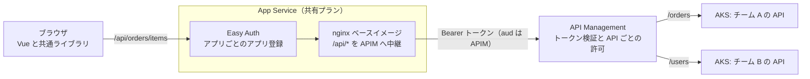

# 社内共通 UI ライブラリへの認証の組み込み（Easy Auth ＋ APIM ＋ AKS）

## 概要

社内の共通 UI ライブラリ・アプリのテンプレート・Docker イメージに、認証とトークンの扱いを組み込むときの設計の整理。
各チームのコードには、**トークンも認証の設定も一切出てこない**ようにする。

> このリポジトリは公開されているため、実際のホスト名・クライアント ID・テナント ID・IP アドレスの範囲はここに書かない。例はすべて仮の値。

### 前提

- 社内向けの業務アプリ。フロントは Vue 3、HTTP クライアントは Axios、状態管理ライブラリ（Pinia など）は使わない
- フロントは App Service のコンテナで動かす。共有の App Service プランから各チームに払い出すので、重い処理はコストが増え、他チームにも影響する
- 認証は Easy Auth（Entra ID の SSO）
- API は AKS で動かし、API Management（APIM）で保護する。API のドメインはチームごとに違う
- 1 つのアプリが複数の API を呼ぶことがある
- アプリ登録（Entra ID）はアプリごとに作る
- 各チームのエンジニアはクラウドや REST API に詳しくない。基盤チームが共通 UI ライブラリ・テンプレート・Docker イメージを配布して、運用の負荷を減らしたい

関連:

- [App Service の Easy Auth と nginx でトークンを中継する](easy-auth-token-relay.md)（nginx の設定、`/.auth/me` の遮断）
- [SPA のトークンの置き場所](../web-security/spa-token-storage.md)
- [XSS](../web-security/xss.md)

## 方針

1. **アプリのコードにトークンを見せない**。ライブラリにも `getToken()` のような関数を作らない。触れる手段がなければ、localStorage への保存やログへの出力といった誤用も起きない
2. **処理はすべて「設定」で済ませる**。トークンの保持と更新は Easy Auth、付け替えは配布する nginx イメージ、検証は APIM。各チームは認証のコードを書かない
3. **トークンの宛先（`aud`）を APIM の 1 つにまとめる**。Easy Auth が持てるアクセストークンは 1 つの API 向けだけなので、宛先を APIM にすれば 1 つのトークンで複数の API を呼べる。チームごとの API のドメインは APIM のバックエンド設定に吸収され、フロントからは見えない
4. **共有環境の負荷を増やさない**。Node の BFF サーバーは置かず、コンテナは nginx だけ。トークンの更新は 401 が返ったときだけ
5. **Easy Auth の設定は払い出し時に基盤側が IaC で入れる**。各チームには Azure の設定を触らせない

## 全体像



| 部品 | 作る・設定する人 | トークンとの関わり |
|---|---|---|
| アプリのコード | 各チーム | 触れない |
| 共通 UI ライブラリ | 基盤チーム | 触れない（更新を Easy Auth に頼むだけ） |
| nginx ベースイメージ | 基盤チーム | ヘッダーを付け替えるだけ。保存しない |
| Easy Auth | 基盤チーム（払い出し時） | 保持と更新 |
| APIM | 基盤チームと API のチーム | 検証と、API ごとの呼び出し許可 |

| 誰が | やること |
|---|---|
| フロントのチーム | `createApiClient('orders')` で呼ぶだけ。ドメイン・トークン・Azure の設定には触れない |
| API のチーム | APIM に API を登録する（URL サフィックスとバックエンド）。呼び出しを許可するフロントを追加する。利用者 ID はヘッダーから読む |
| 基盤チーム | ベースイメージとライブラリの提供、払い出し（アプリ登録・Easy Auth・`API_HOST`）、APIM 用のアプリ登録の管理 |

## アプリ登録の設計

| アプリ登録 | 数 | 中身 |
|---|---|---|
| APIM（社内 API） | 環境ごとに 1 つ | スコープ `access_as_user` を 1 つだけ公開する。利用者の権限はアプリロール（`Orders.Read` など）で表す |
| 各フロント | アプリごと | リダイレクト URI と、APIM の `access_as_user` への委任アクセス許可（管理者の同意まで払い出しで済ませる） |

- **スコープは API ごとに分けず 1 つにする**。「どのフロントがどの API を呼べるか」は、APIM 側でフロントのクライアント ID によって判定する。こうすると、フロントが新しい API を使い始めても Easy Auth の設定は変わらない（API ごとにスコープを分けると、そのたびにフロントの設定変更と再ログインが必要になる）
- **APIM 用のアプリ登録は環境（開発・検証・本番）ごとに分ける**。開発環境のトークンが本番で通らないようにするため

Easy Auth の `loginParameters` は、環境ごとに全アプリ共通の値になる。

```
scope=openid profile email offline_access api://company-apim/access_as_user
```

アプリごとに違うのはクライアント ID とリダイレクト URI だけなので、払い出しを丸ごと自動化できる（Microsoft Graph の Bicep 拡張や az CLI で、アプリ登録の作成から同意まで）。
Easy Auth のその他の設定は [Easy Auth の中継](easy-auth-token-relay.md#easy-auth-の設定) を参照。

## APIM のポリシー

API ごとに次のようなポリシーを置く。

```xml
<!-- 注文 API のポリシー（API ごとに置く） -->
<inbound>
  <base />
  <validate-azure-ad-token tenant-id="{{tenant-id}}" output-token-variable-name="jwt">
    <!-- この API を呼んでよいフロントのクライアント ID -->
    <client-application-ids>
      <application-id>{{app-sales-portal-client-id}}</application-id>
      <application-id>{{app-stock-viewer-client-id}}</application-id>
    </client-application-ids>
    <audiences>
      <audience>{{apim-api-audience}}</audience>
    </audiences>
    <required-claims>
      <claim name="scp" match="any" separator=" ">
        <value>access_as_user</value>
      </claim>
    </required-claims>
  </validate-azure-ad-token>
  <!-- 検証済みの利用者 ID をヘッダーで渡す。クライアントが送った同名ヘッダーは上書きする -->
  <set-header name="X-User-Id" exists-action="override">
    <value>@(((Jwt)context.Variables["jwt"]).Claims.GetValueOrDefault("oid", ""))</value>
  </set-header>
  <set-header name="X-User-Roles" exists-action="override">
    <value>@(((Jwt)context.Variables["jwt"]).Claims.GetValueOrDefault("roles", ""))</value>
  </set-header>
</inbound>
```

- **`aud` の形はトークンのバージョンで変わる**。v1 なら `api://...`、v2 ならクライアント ID。APIM 用のアプリ登録でバージョンを固定するか、`audiences` に両方を書く
- **AKS の API には APIM 以外から届かないようにする**（内部ロードバランサー、ネットワークポリシー）。これが守られていれば、API のチームは JWT を検証しなくても `X-User-Id` を信用できる。検証したいチームのために、`Authorization` ヘッダーもそのまま転送しておく
- **サブスクリプションキーは不要にする**。アプリの識別はトークンのクライアント ID でできる。アプリごとの流量制限をしたい場合は、`rate-limit-by-key` のキーにクライアント ID を使う
- **API のチームとの取り決め**として、「認証以外の理由で 401 を返さない（権限不足は 403）」を決めておく。ライブラリは 401 を受けたらログインに誘導するので、守られないとログインが繰り返される
- 呼び出しは nginx からのサーバー間通信なので、APIM に CORS の設定は要らない

## 配布する Docker イメージ

各チームの Dockerfile は、ビルドしてベースイメージにコピーするだけにする。

```dockerfile
# 各チームの Dockerfile（テンプレートに入れて配布する）
FROM node:24-alpine AS build
WORKDIR /app
COPY package*.json ./
RUN npm ci
COPY . .
RUN npm run build

FROM registry.example.com/platform/spa-base:1
COPY --from=build /app/dist /usr/share/nginx/html
```

ベースイメージには、トークンの扱いとセキュリティの設定をすべてまとめる。修正が必要になっても、ベースイメージを更新すれば全アプリに行き渡る。

```dockerfile
# 基盤チームが配布するベースイメージ（実際はバージョンを固定する）
FROM nginx:stable-alpine
COPY snippets/ /etc/nginx/snippets/
COPY templates/ /etc/nginx/templates/
```

nginx の設定は [Easy Auth の中継](easy-auth-token-relay.md#nginx-の設定) のものをそのまま使い、`API_HOST` には APIM のホスト名を入れる（環境ごとに 1 つなので、払い出し時に基盤側でアプリ設定に入れる）。

```
/api/orders/items → https://<APIM のホスト名>/orders/items
```

フロントから呼べるのは APIM 経由の API だけ、というルールにもなる。

## Vue ライブラリ

### 各チームが書くコード

```ts
// main.ts（テンプレートに入れて配布する）
const app = createApp(App);
installAuthGuard(router);
app.use(router).mount('#app');
```

```ts
// 各画面のコンポーネント
const orders = createApiClient('orders'); // APIM の API URL サフィックスと同じ名前
const { data: items } = await orders.get<Item[]>('/items');
const { user, hasRole } = useUser();
```

### ライブラリの中身

API クライアント（Axios）:

```ts
import axios, { type AxiosInstance, type InternalAxiosRequestConfig } from 'axios';
import { login } from './login';

type RetriableConfig = InternalAxiosRequestConfig & { _retried?: boolean };

let refreshing: Promise<boolean> | null = null;

// 同時に複数の 401 が返っても、トークンの更新は 1 回にまとめる
function refreshOnce(): Promise<boolean> {
  refreshing ??= fetch('/.auth/refresh')
    .then((res) => res.ok)
    .catch(() => false)
    .finally(() => {
      refreshing = null;
    });
  return refreshing;
}

// API ごとのクライアント。/api/<API名>/... を呼ぶ
export function createApiClient(apiName: string): AxiosInstance {
  const client = axios.create({
    baseURL: `/api/${apiName}`,
    headers: { 'X-CSRF': '1' },
  });

  client.interceptors.response.use(
    (response) => response,
    async (error: unknown) => {
      if (!axios.isAxiosError(error) || error.response?.status !== 401 || !error.config) {
        throw error;
      }
      const config = error.config as RetriableConfig;
      // 1 回目の 401 なら、トークンを更新して同じリクエストをやり直す（定期的な更新はしない）
      if (!config._retried && (await refreshOnce())) {
        config._retried = true;
        return client.request(config);
      }
      // 更新できない、または更新しても 401 ならログインへ
      login();
      throw error;
    },
  );

  return client;
}
```

ログインとログアウト:

```ts
const LOGIN_AT_KEY = 'platform:loginAt';

export class AuthLoopError extends Error {}

// ログイン直後にまた 401 が返ったら、ログインを繰り返さずにエラーにする
export function login(returnPath = location.pathname + location.search): void {
  const last = Number(sessionStorage.getItem(LOGIN_AT_KEY) ?? 0);
  if (Date.now() - last < 60_000) {
    throw new AuthLoopError('ログイン直後に認証エラーが続いています');
  }
  sessionStorage.setItem(LOGIN_AT_KEY, String(Date.now()));
  location.assign(`/.auth/login/aad?post_login_redirect_uri=${encodeURIComponent(returnPath)}`);
}

export function logout(): void {
  location.assign('/.auth/logout?post_logout_redirect_uri=/');
}
```

sessionStorage に入れているのはログインした時刻だけで、トークンではない。

利用者情報（`/.auth/me` はトークンを含むので使わない）:

```ts
import { readonly, shallowRef } from 'vue';

export type User = { name: string; roles: string[] };

type ClientPrincipal = {
  name_typ: string;
  role_typ: string;
  claims: { typ: string; val: string }[];
};

let userCache: Promise<User | null> | null = null;

// 利用者情報は、ページを開いている間 1 回だけ取得する
export function getUser(): Promise<User | null> {
  userCache ??= fetchUser();
  return userCache;
}

async function fetchUser(): Promise<User | null> {
  const res = await fetch('/_platform/me');
  if (!res.ok) {
    return null;
  }
  // Base64 の JSON。日本語の名前を含むので UTF-8 として復号する
  const bytes = Uint8Array.from(atob(await res.text()), (c) => c.charCodeAt(0));
  const principal = JSON.parse(new TextDecoder().decode(bytes)) as ClientPrincipal;
  const values = (typ: string): string[] =>
    principal.claims.filter((c) => c.typ === typ).map((c) => c.val);
  // クレームの種類名は、実際のヘッダーの中身を見て確認する
  return {
    name: values(principal.name_typ)[0] ?? '',
    roles: values(principal.role_typ),
  };
}

const user = shallowRef<User | null>(null);
const loaded = shallowRef(false);

// どのコンポーネントから呼んでも同じ状態を共有する
export function useUser() {
  if (!loaded.value) {
    void getUser().then((u) => {
      user.value = u;
      loaded.value = true;
    });
  }
  // 画面の出し分け用。実際の権限チェックは APIM と API 側で行う
  const hasRole = (role: string): boolean => user.value?.roles.includes(role) ?? false;
  return { user: readonly(user), loaded: readonly(loaded), hasRole };
}
```

画面のガード（vue-router）:

```ts
import type { Router } from 'vue-router';
import { getUser } from './user';
import { login } from './login';

// meta.public が付いていない画面は、ログインしていなければログインへ
export function installAuthGuard(router: Router): void {
  router.beforeEach(async (to) => {
    if (to.meta.public === true || (await getUser())) {
      return true;
    }
    login(to.fullPath);
    return false;
  });
}
```

補足:

- `X-CSRF` ヘッダーを nginx で必須にしているので、ライブラリを通さない素の `fetch` や Axios は 403 になる。結果的にライブラリ経由の呼び出しを強制できる
- APIM には API の OpenAPI 定義があるので、`openapi-typescript` などで型を生成してクライアントに付けられる。REST に慣れていないエンジニアには、補完が効くだけでもかなり楽になる
- ライブラリの部品（表のセル、ツールチップ、通知など）は HTML の文字列を受け取らない設計にする。必要なら内部で DOMPurify を通す。部品の XSS は全アプリに影響する

## ローカル開発

テンプレートの `vite.config.ts` に、ライブラリが提供する Vite プラグインを入れる。

```ts
export default defineConfig({
  plugins: [vue(), platformDev({ apimHost: 'apim-dev.example.com' })],
});
```

- `/_platform/me` はダミーの利用者を返す
- `/api` は開発用の APIM に中継し、`az login` 済みの Azure CLI から取得したトークンを付ける

このために、開発環境の APIM 用アプリ登録で Azure CLI を事前承認し、開発環境の APIM ポリシーだけ Azure CLI のクライアント ID も許可する。各エンジニアがやるのは `az login` を 1 回するだけ。

## 共有環境の負荷とコスト

- **コンテナは nginx だけ**。メモリも CPU もごく小さく、Node の BFF を置くより大幅に軽い。トークンの検証は APIM、業務処理は AKS が担う
- **トークンの更新は 401 のときだけ、同時に来ても 1 回にまとめる**。多数のアプリが定期的に更新し続ける状態を避ける
- **静的ファイルは長くキャッシュする**。ハッシュ付きのファイルは `immutable` にし、`index.html` だけ毎回確認させる。全リクエストが Easy Auth を通るので、リクエスト数を減らす効果が大きい
- **利用者情報はページごとに 1 回だけ取得する**

## 運用の流れ

- **新しいアプリを作る**: 基盤側の払い出しでアプリ登録・Easy Auth・`API_HOST` が入り、チームはテンプレートから作るだけ
- **アプリが新しい API を使い始める**: API のチームが APIM のポリシーにフロントのクライアント ID を足すだけ。フロント側の設定変更も再ログインも不要
- **API のドメインが変わる**: APIM のバックエンド設定を変えるだけで、フロントには影響しない
- **セキュリティの設定を直す**（CSP、ヘッダーの扱いなど）: ベースイメージを更新し、各チームはテンプレートどおりにバージョンを上げる

## 既存の構成からの移行

「ライブラリが `/.auth/me` から取ったトークンを localStorage に保存し、API のドメインは起動時に JS を書き換えて差し込む」構成から移行する場合の手順。

1. **ベースイメージに nginx の中継を追加する**。`/api/` を APIM へ中継する設定と `/_platform/me` を入れ、払い出し済みの各アプリのアプリ設定に `API_HOST` を足す。この時点では今の方式と並存できる
2. **ライブラリの中身を切り替える**
   - API の呼び先を、絶対 URL から相対パス `/api/<API名>/...` に変える
   - `Authorization` ヘッダーの付与と localStorage への保存をやめる
   - 401 が返ったら `/.auth/refresh` して再実行する処理を入れる
   - 利用者情報の取得を `/.auth/me` から `/_platform/me` に変える

   公開している関数の形を変えずに中身だけ差し替えられれば、各チームはバージョンを上げるだけで済む。新しいライブラリは新しいベースイメージが前提になるので、テンプレートでは 2 つをセットで上げる
3. **残っている古いトークンを消す**。利用者のブラウザの localStorage には旧ライブラリのトークンが残っているので、新しいライブラリの起動時に `localStorage.removeItem(...)` で消す
4. **後片付け**。全アプリの移行が終わったら、APIM の CORS 設定と、JS を書き換える起動スクリプトを削除する
5. **Front Door の WAF で `/.auth/me` を遮断する**（[Easy Auth の中継](easy-auth-token-relay.md#authme-の問題と-front-door-での遮断) を参照）

移行前に、各チームのコードがトークンを直接使っている箇所（`getToken()` のような関数を呼んで自分で通信している、Microsoft Graph など APIM 以外を呼んでいる、など）を洗い出す。移行後は動かなくなるので、APIM の後ろに回すか、別の扱いを決める。

## 優先順位

1. **XSS を防ぐ仕組みを、ライブラリ・テンプレート・ベースイメージに組み込む**。全アプリの土台を握っているので、いちばん効果が大きい
   - UI ライブラリの部品は HTML の文字列を受け取らない
   - テンプレートの ESLint 設定で `vue/no-v-html` をエラーにする
   - ベースイメージの nginx で CSP を付ける
2. **API 側（APIM か Front Door）で IP 制限が掛かっているかを確認する**。掛かっていれば、トークンの持ち出しは低いリスクとして扱える
3. **nginx の中継に移行し、最後に `/.auth/me` を遮断する**

すぐに移行できない場合の当面の対策は、localStorage から sessionStorage に変える、リフレッシュトークンは保存しない、トークンがログや監視ツールに出ていないかを確認する、の 3 つ。

## 確認が必要な点

- [Easy Auth の中継の「確認が必要な点」](easy-auth-token-relay.md#確認が必要な点)
- `validate-azure-ad-token` の `required-claims` で、`scp` のような空白区切りのクレームを `separator` で扱えるか
- 開発環境で Azure CLI のトークンを使う方式が、社内のポリシー上許されるか
- Front Door で複数のアプリを同じホスト名のパスにまとめていないか（まとめていると、localStorage と Easy Auth のクッキーがアプリ間で共有される）

## 参考

- [API Management の validate-azure-ad-token ポリシー](https://learn.microsoft.com/ja-jp/azure/api-management/validate-azure-ad-token-policy)
- [チュートリアル: Azure App Service でエンドツーエンドでユーザーを認証・認可する](https://learn.microsoft.com/ja-jp/azure/app-service/tutorial-auth-aad)
