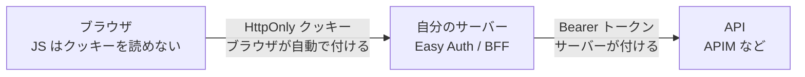

# HttpOnly クッキー

## 概要

HttpOnly クッキーは、**JS からは読めないが、ブラウザがリクエストに自動で付けて送ってくれるクッキー**。
SSR（サーバーサイドレンダリング）専用ではなく、SPA の `fetch` にも付く。必要なのは画面の作り方ではなく、**クッキーを発行して受け取るサーバー**。

例: App Service の Easy Auth がログイン後に発行する `AppServiceAuthSession` も HttpOnly クッキーで、SPA が `fetch('/api/...')` を呼ぶとブラウザが自動で付けて送っている。

## 仕組み

クッキーは、サーバーが `Set-Cookie` ヘッダーで発行し、ブラウザが保存して、以降そのサーバーへのリクエストに自動で付けるもの。
普通のクッキーは JS からも `document.cookie` で読み書きできるが、`HttpOnly` 属性を付けると JS からは見えなくなる。

```http
# サーバーがログイン後に発行する
HTTP/1.1 302 Found
Set-Cookie: __Host-session=abc123; Path=/; Secure; HttpOnly; SameSite=Lax
```

```http
# 以降、ブラウザが自動で付けて送る
GET /api/orders/items HTTP/1.1
Cookie: __Host-session=abc123
```

```ts
document.cookie; // HttpOnly のクッキーは含まれない（読めない）
await fetch('/api/orders/items'); // それでもリクエストには自動で付く（同じオリジンなら既定で付く）
```

ポイントは「**JS は読めないけれど、送ることはできる（ブラウザが代わりに付ける）**」こと。XSS されても、値そのものは持ち出されない。

## 「SSR 専用」ではない

Next.js や Nuxt のような SSR のフレームワークでは、もともとサーバーがあるので HttpOnly クッキーがよく使われる。そこから「SSR 専用」という印象になりやすい。
実際に必要なのは、クッキーを発行して受け取るサーバー（BFF、Easy Auth、自前の API など）で、SPA でもそのサーバーに `fetch` すればクッキーは付く。

## 使える場面・使えない場面

| 場面 | 使えるか | 理由 |
|---|---|---|
| SPA から、同じオリジンの自分のサーバー（Easy Auth、BFF）を呼ぶ | 使える | いちばん素直な使い方 |
| SPA から、同じサイトの別のオリジンを呼ぶ（`app.example.com` から `api.example.com`） | 使える | `credentials: 'include'` と、クッキー付きリクエストを許可する CORS の設定が必要 |
| SPA から、別サイトの API を呼ぶ（`*.azurewebsites.net` から `*.azure-api.net` など） | 使えない | サードパーティクッキー扱いになり、Safari や Firefox は既定でブロックする。Chrome も利用者の設定でブロックされることがある |
| 外部の API（Microsoft Graph など）をブラウザから直接呼ぶ | 使えない | 外部の API は `Authorization: Bearer` ヘッダーを求める。JS がクッキーの値を読めないので、ヘッダーに入れられない |
| サーバーの無い静的ホスティング（S3 だけ） | 使えない | クッキーを発行・確認するサーバーがいない |
| サーバー同士の通信（nginx から APIM など） | 向かない | ブラウザがいないので、トークンをヘッダーで送るのが普通 |
| モバイルアプリや CLI | 向かない | トークンを使うのが標準 |
| JS が値を使いたい（利用者名を表示したい、など） | 使えない | 読めないので、利用者情報を返すエンドポイントを別に用意する |

`azurewebsites.net` は「パブリックサフィックス」（`.com` のように、その下の名前ごとに別サイトとして扱われるドメイン）に登録されている。
そのため、`app-a.azurewebsites.net` と `app-b.azurewebsites.net` も別のサイト扱いになる。`cloudfront.net` なども同様。

## 使い分けの考え方



**ブラウザと自分のサーバーの間はクッキー、サーバーと API の間はトークン**、と分けるのが基本。

## 主な属性

| 属性 | 意味 |
|---|---|
| `HttpOnly` | JS（`document.cookie`）から読み書きできない |
| `Secure` | HTTPS のときだけ送る |
| `SameSite=Strict` | 別サイトから来たリクエストには一切付けない |
| `SameSite=Lax` | 別サイトからは、リンクでの画面遷移（GET）のときだけ付ける。Chrome などでは、指定しないとこの扱いになる |
| `SameSite=None` | 別サイトからでも付ける（`Secure` が必須）。サードパーティクッキーとしてブロックされやすい |
| `Domain` | 省略するとそのホストだけに送る。指定するとサブドメインにも送る |
| `Path` | 送るパスの範囲 |
| `Max-Age` / `Expires` | 有効期限。省略するとブラウザを閉じるまで |
| `__Host-` 接頭辞（名前の先頭） | `Secure`・`Path=/`・`Domain` なしを強制し、サブドメインから上書きされないようにする |

## トークンを JS に持たせる方式との比較

| | JS が持つトークン（`Authorization` ヘッダー） | HttpOnly クッキー |
|---|---|---|
| 誰が付けるか | JS が毎回付ける | ブラウザが自動で付ける |
| JS から読めるか | 読める | 読めない |
| XSS で持ち出されるか | される | されない |
| XSS で、開いている間に使われるか | される | される（JS からの `fetch` にも自動で付くため） |
| CSRF | 起きない（自動では付かない） | 対策が必要（`SameSite` と独自ヘッダー） |
| 送れる相手 | どこでも（CORS 次第） | クッキーを発行したサーバー（同じサイトまで） |
| 必要なもの | なし | クッキーを発行・確認するサーバー |

## HttpOnly でも防げないもの

- **XSS で、開いている間に使われること**。防げるのは持ち出しだけ
- **CSRF**。ブラウザが自動で付けるので、別のサイトからリクエストを送らせる攻撃が成り立つ。対策は次の 2 つの組み合わせ
  - `SameSite=Lax` か `Strict`
  - API 呼び出しに独自ヘッダー（`X-CSRF: 1` など）を必須にする。独自ヘッダー付きのリクエストは別のオリジンから送ると CORS の事前確認が必要になり、許可しなければ送れない

トークンを JS に持たせる方式とは、「XSS での持ち出し」と「CSRF」のどちらのリスクを取るかの交換になっている。
CSRF は上の対策でほぼ防げるので、一般には HttpOnly クッキーのほうが安全とされる。

## 参考

- [MDN: HTTP Cookie の使用](https://developer.mozilla.org/ja/docs/Web/HTTP/Cookies)
- [Public Suffix List](https://publicsuffix.org/)
