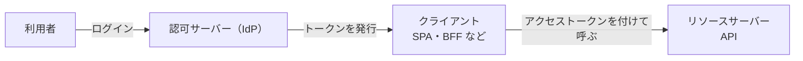
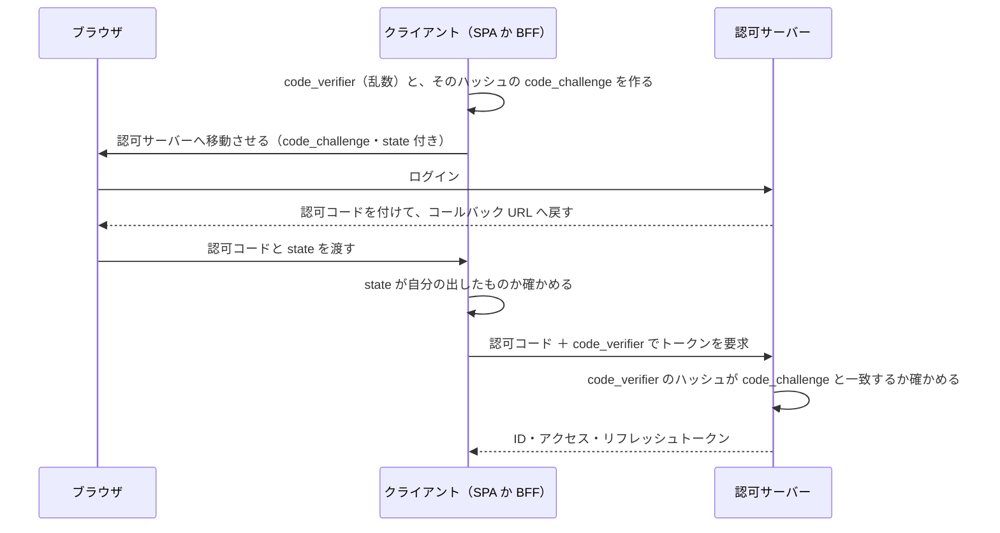

# OAuth 2.0 と OpenID Connect の基礎

## 概要

SPA の認証やトークンの置き場所を考えるときの前提になる、OAuth 2.0 と OpenID Connect（OIDC）の用語と仕組みの整理。
Entra ID・Cognito・Auth0 などの IdP（ID プロバイダー）は、どれもこの仕組みの上に作られている。

関連:

- [オリジン・サイト・クッキー・CORS・CSRF](origin-cookie-cors-csrf.md)
- [SPA のトークンの置き場所](spa-token-storage.md)
- [SPA の認証構成パターン](spa-auth-architecture.md)

## 登場人物

| 役割 | 意味 | 例 |
|---|---|---|
| リソースオーナー | データの持ち主。ログインする利用者 | 会員、社員 |
| クライアント | 利用者の代わりに API を呼ぶアプリ | SPA、BFF、モバイルアプリ |
| 認可サーバー（IdP） | ログインを受け付け、トークンを発行する | Cognito、Entra ID、Auth0 |
| リソースサーバー | トークンを受け取って処理する API | 業務 API |



## OAuth と OIDC の違い

- **OAuth 2.0**: 「API を呼んでよい」という**権限の受け渡し**の仕組み。アクセストークンを発行する
- **OpenID Connect（OIDC）**: OAuth の上に「**誰がログインしたか**」を伝える仕組みを足したもの。ID トークンを発行する

「ログイン」に使っているのは実際には OIDC で、API を呼ぶ部分が OAuth、という関係になる。

## 3 つのトークン

| トークン | 誰のためのものか | 中身・用途 | 有効期間の目安 |
|---|---|---|---|
| ID トークン | クライアント | ログインした人が誰か（名前・メールなど）。クライアントが読んで使う | 短い（数分〜1 時間） |
| アクセストークン | API | API を呼ぶ権限（スコープ・ロール）。API に `Authorization: Bearer` で送る | 短い（数分〜1 時間） |
| リフレッシュトークン | 認可サーバー | 新しいアクセストークンを取り直すためのもの。API には送らない | 長い（数時間〜数十日） |

- **API には ID トークンではなくアクセストークンを送る**。ID トークンはクライアント向けのもので、API で使う前提になっていない
- **最も価値が高いのはリフレッシュトークン**。期限が長く、盗まれると新しいアクセストークンを取り続けられる。どこに置くかを一番慎重に決める

## JWT の中身と検証

多くの IdP は、ID トークンとアクセストークンを JWT（JSON Web Token）で発行する。`ヘッダー.ペイロード.署名` の 3 つを `.` でつないだもの。

```json
{
  "iss": "https://idp.example.com/",
  "sub": "6f1c2a9e-...",
  "aud": "my-api",
  "exp": 1767225600,
  "iat": 1767222000,
  "scope": "orders.read"
}
```

- ペイロードは Base64url で**エンコードされているだけで、暗号化されていない**。誰でも中身を読めるので、秘密の情報は入れない
- 改ざんされていないことは、IdP の公開鍵（JWKS として公開されている）で署名を確かめて判断する

API がアクセストークンを受け取ったときに確かめること:

| 項目 | 確かめること |
|---|---|
| 署名 | IdP の公開鍵で検証できるか |
| `iss`（発行元） | 信頼している IdP か |
| `aud`（宛先）など | 自分の API 向けか（IdP によっては `client_id` などで表す） |
| `exp`（期限） | 切れていないか |
| スコープ・ロール | その操作をしてよい権限があるか |

### 自己完結型のトークンと失効

JWT は、API が IdP に問い合わせなくても、署名と中身だけで検証できる（自己完結型）。速い反面、**ログアウトなどで失効させても、API 側の検証は期限が来るまで通ってしまう**ことが多い。
そのため、アクセストークンの期限は短くし、失効はリフレッシュトークンの側で効かせる、という考え方になる。

## 認可コードフロー ＋ PKCE

ブラウザを使うアプリで標準になっているログインの流れ。



| パラメータ | 防ぐもの |
|---|---|
| PKCE（`code_verifier` と `code_challenge`） | 認可コードを途中で盗まれても、`code_verifier` を知らないとトークンに交換できない |
| `state` | 攻撃者の用意したログイン結果を、被害者のブラウザに受け取らせる攻撃（ログイン CSRF） |
| `nonce` | ID トークンの使い回し。ID トークンに同じ値が入っているかを確かめる |

## 公開クライアントと機密クライアント

| 種類 | 意味 | 例 | トークンを取るときの認証 |
|---|---|---|---|
| 公開クライアント | 秘密の値を安全に持てない | SPA、モバイルアプリ | PKCE だけ |
| 機密クライアント | 秘密の値をサーバー側に持てる | BFF、サーバーで動くアプリ | クライアントシークレット（や証明書）＋ PKCE |

SPA のコードはブラウザに配られて誰でも読めるので、クライアントシークレットを入れても秘密にならない。
**ブラウザで動く SPA は必ず公開クライアント**になり、リフレッシュトークンを盗まれると、それだけで新しいトークンを取られてしまう。
BFF は機密クライアントなので、リフレッシュトークンが漏れても、シークレットが無ければ使えない。

## 使わないフロー

| フロー | 理由 |
|---|---|
| インプリシットフロー | トークンを URL に載せて返すので漏れやすい。今は認可コード ＋ PKCE を使う |
| パスワードをクライアントが直接受け取るフロー（ROPC など） | クライアントがパスワードを扱うことになり、IdP 側の多要素認証や SSO の利点を活かしにくい。自社のサーバーが自社の IdP に対して使う場合などに限る |

## リフレッシュトークンの守り方

- **有効期間を必要な長さにする**。「1 営業日」など、業務で必要な長さから決める
- **ローテーション**: 使うたびに新しいリフレッシュトークンに差し替え、古いものを無効にする。盗まれたものが使われると、正規の側との食い違いで気づける
- **送信者制約（DPoP など）**: トークンを、クライアントが持つ取り出せない鍵に結び付ける。盗まれても別の場所では使えない。IdP が対応している場合だけ使える
- **そもそもブラウザに置かない**（BFF）

## スコープとロール

- **スコープ**: クライアントに「何をしてよいか」を委ねる範囲（例: `orders.read`）。利用者がアプリに許可する権限
- **ロール**: 利用者そのものの権限（例: 管理者）
- API はアクセストークンに入っている両方を見て、操作を許可するかを決める

## 参考

- [RFC 6749: The OAuth 2.0 Authorization Framework](https://www.rfc-editor.org/rfc/rfc6749)
- [RFC 7636: Proof Key for Code Exchange（PKCE）](https://www.rfc-editor.org/rfc/rfc7636)
- [RFC 9700: Best Current Practice for OAuth 2.0 Security](https://www.rfc-editor.org/rfc/rfc9700)
- [OpenID Connect Core 1.0](https://openid.net/specs/openid-connect-core-1_0.html)
