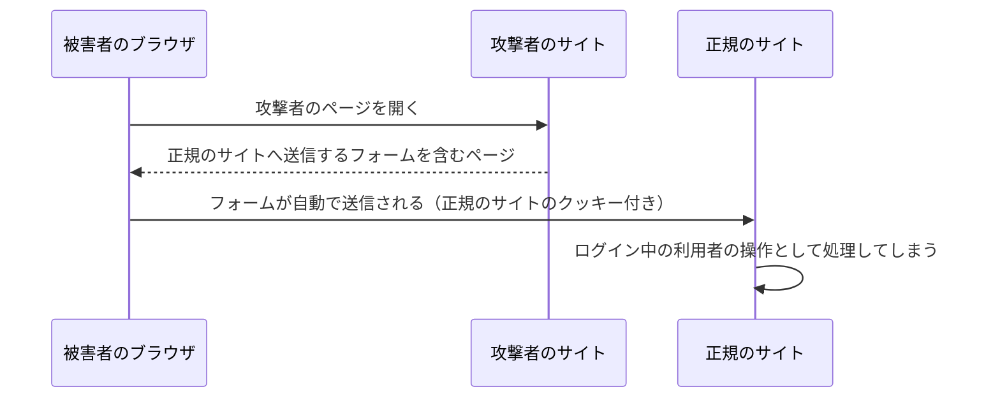

# オリジン・サイト・クッキー・CORS・CSRF

## 概要

BFF や API を「同じオリジンに置く」理由を理解するための前提知識の整理。
オリジンとサイトの違い、クッキーが送られる条件、CORS、CSRF の順に説明し、最後に同じオリジンに置く理由をまとめる。

関連:

- [OAuth 2.0 と OpenID Connect の基礎](oauth-oidc-basics.md)
- [HttpOnly クッキー](httponly-cookie.md)
- [SPA の認証構成パターン](spa-auth-architecture.md)

## オリジンとサイト

| 用語 | 定義 | 例 |
|---|---|---|
| オリジン | スキーム ＋ ホスト ＋ ポートの組 | `https://app.example.com:443` |
| サイト | スキーム ＋ 登録可能なドメイン（`example.com` の部分） | `https://example.com` |

| 比べる 2 つ | 同じオリジンか | 同じサイトか |
|---|---|---|
| `https://example.com` と `https://example.com/api` | 同じ（パスは関係ない） | 同じ |
| `https://app.example.com` と `https://api.example.com` | 違う（ホストが違う） | 同じ |
| `https://example.com` と `http://example.com` | 違う（スキームが違う） | 違う |
| `https://example.com` と `https://example.com:8443` | 違う（ポートが違う） | 同じ |
| `https://a.cloudfront.net` と `https://b.cloudfront.net` | 違う | **違う** |
| `https://example.com` と `https://example-api.net` | 違う | 違う |

`cloudfront.net` や `github.io` のように、その下の名前ごとに別の持ち主がいるドメインは「パブリックサフィックス」として登録されていて、`.com` と同じ扱いになる。
そのため `a.cloudfront.net` と `b.cloudfront.net` は別のサイトになる。

## 同一オリジンポリシー

ブラウザは、あるオリジンで動くスクリプトが、別のオリジンのものに触れるのを制限している。

| 制限されること | 制限されないこと |
|---|---|
| 別のオリジンへの `fetch` の**応答を読む**（CORS で許可されない限り） | 別のオリジンへの**リクエストを送ること自体**（フォームの送信、`fetch` の送信、画像の読み込み） |
| 別のオリジンの DOM、localStorage、sessionStorage に触る | 別のオリジンのスクリプト・画像・CSS を読み込んで使う |

「送ることはできるが、応答は読めない」という点が、CSRF が成り立つ理由になる。

## クッキーが送られる条件

| 属性 | 送られる条件 |
|---|---|
| `Domain` | 省略するとそのホストだけ。指定するとそのドメインとサブドメインに送る |
| `Path` | そのパスの下へのリクエストだけに送る |
| `Secure` | HTTPS のときだけ送る |
| `SameSite=Strict` | 同じサイトからのリクエストだけに送る |
| `SameSite=Lax` | 同じサイトからのリクエストと、別のサイトからのリンクでの画面遷移（GET）に送る。Chrome などでは指定しないとこの扱い |
| `SameSite=None` | どこからのリクエストにも送る（`Secure` が必須） |

ポートはクッキーの区別に使われない。`localhost:8080` と `localhost:9090` は同じクッキーを共有する。

### ファーストパーティとサードパーティ

- **ファーストパーティクッキー**: 今開いているページと同じサイトのクッキー
- **サードパーティクッキー**: 別のサイトのクッキー（埋め込まれた広告、別サイトの API へのリクエストなど）

Safari と Firefox はサードパーティクッキーを既定でブロックしている。Chrome も利用者の設定やシークレットモードでブロックされることがある。
**ログインのクッキーをサードパーティとして使う設計は、ブラウザによって動かない**と考える。

## CORS

CORS（オリジン間リソース共有）は、**サーバーが「このオリジンからなら応答を読んでよい」と許可する**仕組み。同一オリジンポリシーを、サーバーの判断で緩める。

| 種類 | 条件 | 動き |
|---|---|---|
| 単純リクエスト | GET・POST で、独自ヘッダーが無く、`Content-Type` が `text/plain` やフォームの形式 | そのまま送られる。応答を読めるかどうかだけを CORS で判断する |
| 事前確認（プリフライト）付き | 独自ヘッダーがある、`Content-Type: application/json`、PUT・DELETE など | 先に `OPTIONS` で許可を確認してから、本来のリクエストを送る |

クッキー付きで別のオリジンに送る場合（`credentials: 'include'`）は、サーバー側で次がすべて必要になる。

- `Access-Control-Allow-Origin` にオリジンを**具体的に**書く（`*` は使えない）
- `Access-Control-Allow-Credentials: true`
- クッキーが `SameSite=None` か、同じサイトであること

よくある設定ミスは、届いた `Origin` ヘッダーをそのまま `Access-Control-Allow-Origin` に返してしまうこと。どのサイトからでもクッキー付きで応答を読まれる。

## CSRF

CSRF（クロスサイトリクエストフォージェリ）は、**攻撃者のサイトから、被害者のブラウザにリクエストを送らせる**攻撃。ブラウザがクッキーを自動で付けるので、被害者がログイン中なら、その権限で処理されてしまう。

| 対策 | 内容 |
|---|---|
| `SameSite=Lax` か `Strict` | 別のサイトからのリクエストにクッキーを付けない。基本の対策 |
| 独自ヘッダーを必須にする | API に `X-CSRF: 1` のようなヘッダーを必須にする。別のオリジンから付けると事前確認が必要になり、許可しない限り送れない |
| `Origin` や `Sec-Fetch-Site` の確認 | リクエストが自分のオリジンから来たかをサーバーで確かめる（`Sec-Fetch-Site: same-origin`） |
| CSRF トークン | 画面に埋め込んだ推測できない値を、送信時に照合する。サーバーで HTML を返すアプリで一般的 |

注意: `SameSite` は「同じ**サイト**」を基準にするので、**同じドメインの別のサブドメインからの攻撃は防げない**。`lp.example.com` に XSS があれば、そこから `api.example.com` へクッキー付きのリクエストを送れる。`Origin` の確認などを組み合わせる。

なお、XSS されると攻撃コードは正規のオリジンの中で動くので、CSRF の対策はすべて素通りになる。CSRF 対策は XSS 対策の代わりにならない（[XSS](xss.md) を参照）。

## まとめ: BFF や API を同じオリジンに置く理由

BFF は、ブラウザが HttpOnly クッキーを自動で付けて送ることを前提にした仕組み。そのため**絶対に必要なのは、ブラウザがクッキーを送ってくれる配置**で、最低でも同じサイトに置く必要がある。同じオリジンにすると、残りの問題もまとめて片付く。

| 配置 | 例 | クッキー | CORS | CSRF 対策 |
|---|---|---|---|---|
| **同じオリジン** | `example.com` と `example.com/api` | 普通に届く | 不要 | `SameSite` と送信元の確認で足りる |
| 同じサイト・別オリジン | `app.example.com` と `api.example.com` | 届く（`credentials: 'include'` が必要） | クッキー付きを許可する設定が要る | 他のサブドメインからの攻撃も考える |
| 別サイト | `a.cloudfront.net` と `b.example-api.net` | **届かない**（サードパーティクッキー） | ― | ― |

同じオリジンにする利点:

1. **クッキーが確実に届く**。`SameSite=None` に緩める必要もない
2. **CORS が要らない**。設定ミスの余地が無くなり、事前確認の `OPTIONS` も無くなるので API 呼び出しも速くなる
3. **CSRF 対策が単純で確実になる**。`SameSite`、独自ヘッダー、`Sec-Fetch-Site: same-origin` の確認がそのまま効く
4. **ログインの流れが素直になる**。ログイン開始とコールバックが同じオリジンで完結し、コールバックで発行したクッキーをそのまま使える
5. **画面側の設定が減る**。CSP は `connect-src 'self'` で済み、API は相対パス（`/api/...`）で呼べるので、環境ごとに URL を切り替えなくてよい

## 参考

- [MDN: 同一オリジンポリシー](https://developer.mozilla.org/ja/docs/Web/Security/Same-origin_policy)
- [MDN: オリジン間リソース共有（CORS）](https://developer.mozilla.org/ja/docs/Web/HTTP/CORS)
- [OWASP Cross-Site Request Forgery Prevention Cheat Sheet](https://cheatsheetseries.owasp.org/cheatsheets/Cross-Site_Request_Forgery_Prevention_Cheat_Sheet.html)
- [Public Suffix List](https://publicsuffix.org/)
