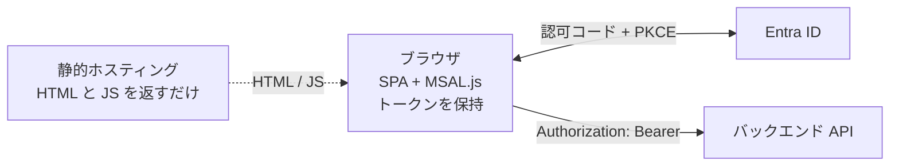
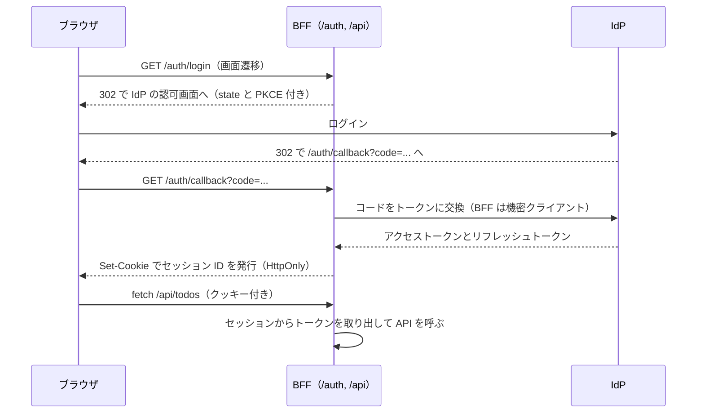
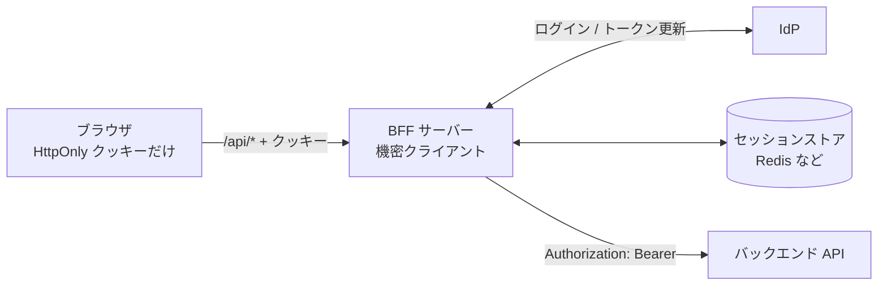
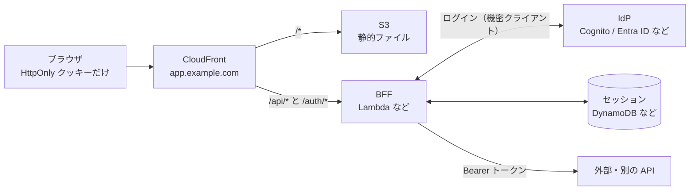

# SPA の認証構成パターン

## 概要

SPA からバックエンドの API を呼ぶときに、トークンを誰が持つかで構成を分けた整理。
静的ホスティング（S3 など）の場合と、Azure での対応も含める。

関連:

- [SPA のトークンの置き場所](spa-token-storage.md)
- [HttpOnly クッキー](httponly-cookie.md)
- [App Service の Easy Auth と nginx でトークンを中継する](../azure/easy-auth-token-relay.md)

## パターン一覧

| パターン | トークンの場所 | サーバー | XSS での持ち出し | 例 |
|---|---|---|---|---|
| A. ブラウザで完結 | ブラウザ（メモリ・sessionStorage） | 不要 | される | MSAL.js ＋ 認可コード ＋ PKCE |
| B. トークン仲介型 | アクセストークンはブラウザ、リフレッシュトークンはサーバー | 必要 | アクセストークンはされる | Easy Auth の `/.auth/me` からトークンを取って JS で付ける |
| C. BFF（Backend for Frontend） | サーバーだけ（ブラウザは HttpOnly クッキー） | 必要 | されない | 自前の BFF、Easy Auth ＋ nginx の中継 ＋ `/.auth/me` の遮断 |

IETF の「OAuth 2.0 for Browser-Based Applications」も、安全な順に BFF、トークン仲介型、ブラウザで完結、と並べている。

## A. ブラウザで完結する（MSAL.js ＋ 認可コード ＋ PKCE）

- サーバーが静的配信だけなので、いちばん単純
- Entra ID でリダイレクト URI を「SPA」として登録すると、リフレッシュトークンの寿命は 24 時間に固定される。持ち出されたときの被害が時間で区切られる
- `cacheLocation` は既定の `sessionStorage` のままにするか、`memoryStorage` にする。`localStorage` は使わない
- 向いている場面: 静的配信だけにしたいとき、複数の API や外部の API をブラウザから直接呼ぶとき

被害を小さくするためにやること:

- 認可コードフロー ＋ PKCE を使う（インプリシットフローは使わない）
- アクセストークンは短命にする。リフレッシュトークンはローテーション（使うたびに新しいものに差し替え、古いものを無効にする）を有効にし、寿命も短くする
- **CSP を必ず付ける**（[XSS](xss.md) を参照）
- IdP が DPoP に対応していれば検討する。トークンを、ブラウザ内の取り出せない鍵に結び付ける仕組みで、トークンが持ち出されても別の場所からは使えなくなる

## B. トークン仲介型

サーバーがログインとトークンの取得を担い、アクセストークンだけをフロントに渡す形。
App Service の Easy Auth で、`/.auth/me` からアクセストークンを取って JS で `Authorization` ヘッダーに付ける構成はこれに当たる。

- リフレッシュトークンは機密クライアント用なので、持ち出されてもクライアントシークレットが無いと使えない
- アクセストークンは JS に渡るので、XSS で持ち出される

## C. BFF

### BFF にアクセストークンは要らない

「BFF を作っても、ブラウザが BFF へのアクセストークンを持つ必要があるのでは」と考えがちだが、要らない。
**ログイン自体を BFF が行い**、その結果としてブラウザにセッションクッキーを発行する。ブラウザと BFF の間で使う資格情報はこのクッキーだけ。

呼びたい API が自前のものなら、**BFF と API を一体にしてもよい**。その場合 API はセッションクッキーで利用者を識別すればよく、OAuth のトークンはどこにも出てこない。
OAuth のトークンが必要になるのは、別のリソースサーバー（外部 API や別チームの API）を呼ぶときだけ。

### 構成

- クッキー: `__Host-` プレフィックス、`HttpOnly`、`Secure`、`SameSite=Lax`（または `Strict`）
- CSRF 対策: SameSite に加えて、API 呼び出しに独自ヘッダー（`X-CSRF: 1` など）を必須にする
- スケールアウトに備えて、セッションストアは共有にする（Redis など）。インスタンスの固定（ARR アフィニティなど）には頼らない
- クライアントシークレット: マネージド ID などをフェデレーション資格情報にしてシークレット自体をなくすのが理想。難しければ Key Vault などで管理する
- ログインの開始は `fetch` ではなく画面遷移（`location.assign('/auth/login')`）で行う。IdP の画面へのリダイレクトは `fetch` では辿れないため

### クッキーが届くかどうかが本当の制約

BFF の制約は「トークンが要る」ことではなく、**クッキーをブラウザが BFF に送ってくれるか**。そのため、BFF と画面を同じオリジン（少なくとも同じサイト）に置く必要がある。

| 画面 | BFF | クッキーの扱い |
|---|---|---|
| `xxx.cloudfront.net` | `yyy.execute-api...amazonaws.com` | 別サイト扱いでサードパーティクッキーになる。**使えない** |
| `app.example.com` | `api.example.com` | 同じサイトなので、`SameSite=Lax/Strict` でも送られる。CORS の設定は必要 |
| `app.example.com` | `app.example.com/api` | 同じオリジン。CORS も不要で、いちばん素直 |

## 静的ホスティング（S3 など）の場合

### おすすめ: CDN で同じオリジンにして BFF を足す

S3 での静的ホスティングはそのままにして、CDN でパスごとに振り分ける。

CloudFront で気をつけること:

- `/api/*` と `/auth/*` のビヘイビア（パスごとの振り分けルール）
  - キャッシュポリシーは `CachingDisabled`
  - オリジンリクエストポリシーは、クッキーとクエリ文字列を転送するもの
  - オリジンが API Gateway や Lambda 関数 URL なら、`Host` ヘッダーを転送すると失敗する。`AllViewerExceptHostHeader` のように Host を除いて転送するものを選ぶ
- セッションの保存先: Lambda は状態を持てないので DynamoDB などに置く。トークンを暗号化してクッキーに直接入れる方法もあるが、クッキーの上限（約 4KB）を超えやすい
- この形なら独自ドメインが無くても動く（`xxx.cloudfront.net` の同一オリジンで成立する）

### その他の選択肢

- **サブドメインで同じサイトにする**: すでに独自ドメインを持っていて、API を別のサブドメインに分けたいとき。CORS は `credentials` 付きで設定する
- **SPA だけで完結させる**: サーバーを置けない、外部 API を直接呼ぶとき。A の「被害を小さくするためにやること」を全部やる

## Azure での対応

| 構成 | Azure での対応 |
|---|---|
| Easy Auth で済ませる | App Service の組み込み認証（Easy Auth）＋ コンテナの nginx で中継。詳しくは [Easy Auth の中継](../azure/easy-auth-token-relay.md) |
| CDN で同じオリジン | Storage の静的 Web サイト ＋ Azure Front Door のパス振り分け ＋ BFF（Functions や App Service） |
| マネージドな BFF | Static Web Apps。組み込みの認証があり、リンクした API（Functions・App Service など）を同じオリジンの `/api` で公開できる |

Static Web Apps は BFF の形をそのままマネージドにしたものに近い。ただし API 側に届くのは利用者の情報（`x-ms-client-principal` ヘッダー）で、アクセストークンではないと理解している。
自前の API で利用者を識別するだけなら十分だが、利用者の権限で外部 API を呼ぶ用途には向かないかもしれない（使う前に最新の仕様を確認する）。

## 選び方

| 状況 | おすすめ |
|---|---|
| 社内ツール・個人開発・学習用で、Entra ID ログイン、App Service で動かす | Easy Auth ＋ nginx の中継（`/.auth/me` は Front Door などで遮断） |
| 一般公開や機微なデータで、トークンを一切ブラウザに出したくない | 自前の BFF |
| 静的サイトの構成を変えたくないが、自前 API がある | CDN で `/api` だけを BFF に振り分ける。BFF と API を一体にしてもよい |
| サーバーを置けない、外部 API をブラウザから直接呼ぶ | ブラウザで完結（PKCE、メモリ保存、CSP、短命トークン） |

どの構成でもやること:

- **同じオリジンにする**。`/api` を中継してオリジンをそろえれば CORS が要らなくなり、クッキーもファーストパーティで扱える
- **API 側でトークンを必ず検証する**（`aud`・`iss`・`scp` または `roles`）
- **CSP で XSS そのものを減らす**
- **SPA のバンドルにシークレットを入れない**。クライアント ID とテナント ID は公開情報なので入れてかまわない

## 参考

- [OAuth 2.0 for Browser-Based Applications（IETF）](https://datatracker.ietf.org/doc/draft-ietf-oauth-browser-based-apps/)
